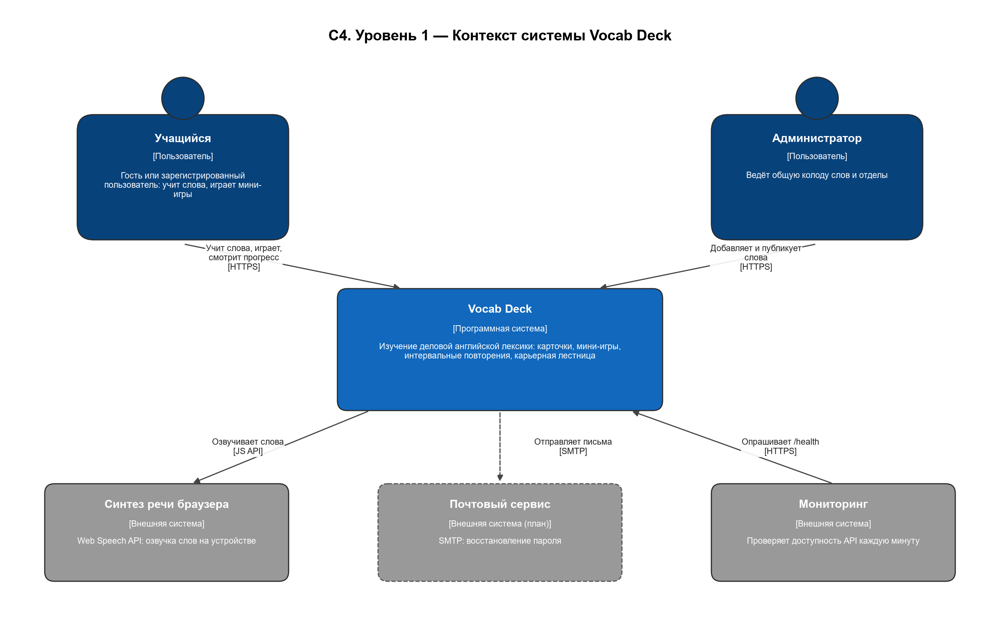
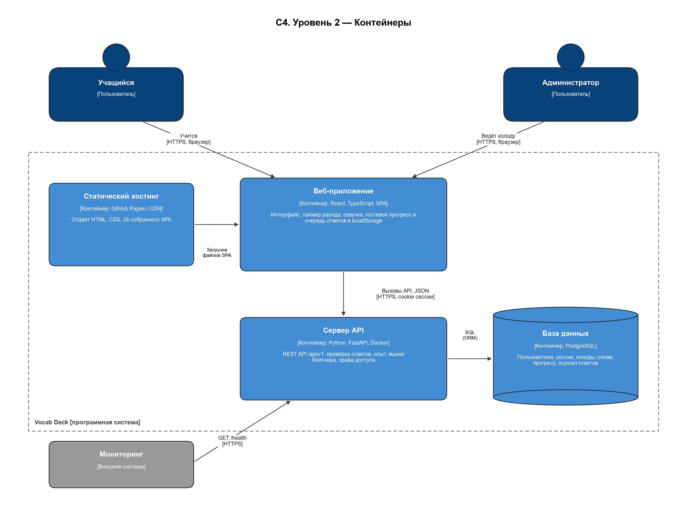
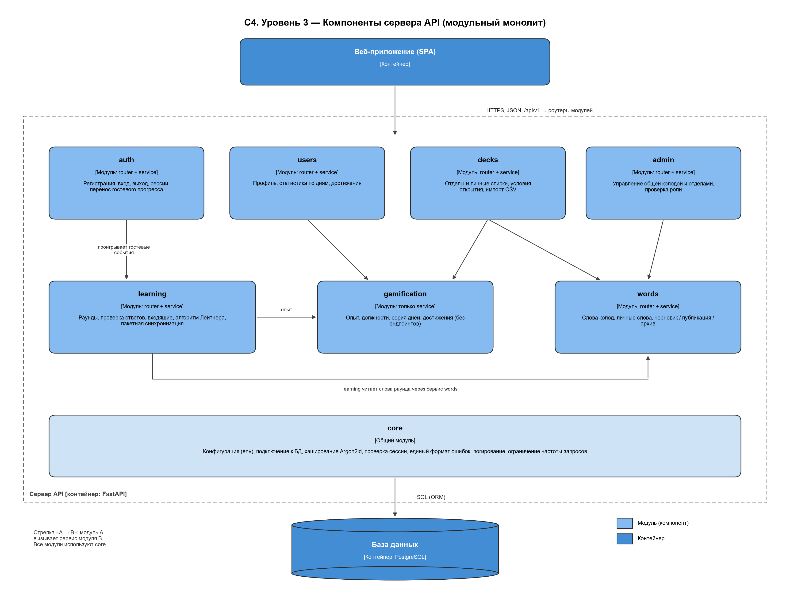

# 1 Архитектура серверной части

## 1.1 Общая схема системы

Система построена по трёхуровневой клиент-серверной архитектуре (рисунок «C4, уровень 2» ниже):

| Уровень | Контейнер | Технология | Ответственность |
|---|---|---|---|
| Клиент | Веб-приложение (SPA) | React, TypeScript, статические файлы на CDN | Интерфейс, озвучка, таймер раунда, хранение гостевого прогресса и очереди неотправленных ответов |
| Логика | Сервер API | Python, FastAPI, Docker-контейнер | Проверка ответов, расчёт опыта, ящиков и серии, права доступа, валидация данных |
| Данные | База данных | PostgreSQL | Учётные записи, колоды, слова, прогресс, журнал ответов |



*C4, уровень 1 — контекст системы*




*C4, уровень 2 — контейнеры*


Клиент не имеет прямого доступа к базе данных: все данные проходят через API, который проверяет права. Это исключает чтение чужого прогресса и подмену результатов.

Внешние системы:
- синтез речи браузера (Web Speech API) — озвучка слов выполняется на устройстве, сервер не участвует;
- почтовый сервис (SMTP) — резервируется для восстановления пароля (в первой версии не используется);
- сервис мониторинга доступности — периодически вызывает `GET /api/v1/health` (NFR-R-05).

## 1.2 Выбор архитектурного стиля

Рассмотрены три стиля из лекции «Архитектура программного обеспечения».

| Критерий | Монолит | Модульный монолит | Микросервисы |
|---|---|---|---|
| Сложность разработки и развёртывания | Низкая | Низкая | Высокая: API Gateway, брокер сообщений, распределённые транзакции |
| Число разработчиков, для которого подходит | 1–5 | 1–10 | Несколько команд |
| Масштабирование | Копиями целиком | Копиями целиком; модули выделяются в сервисы по мере роста | Независимое по сервисам |
| Согласованность данных | Транзакции БД | Транзакции БД | Саги, события, итоговая согласованность |
| Сопровождаемость | Падает с ростом кода | Высокая за счёт границ модулей | Высокая, но выше операционные затраты |
| Стоимость хостинга | Минимальная | Минимальная | Несколько контейнеров, брокер, мониторинг |

**Выбран модульный монолит.** Приложение разрабатывает один человек, нагрузка в целевой версии — до 10 000 пользователей (NFR-M-02), а ключевая операция (ответ в раунде) затрагивает сразу прогресс, опыт, серию и достижения. В монолите это одна транзакция БД; в микросервисах та же операция потребовала бы распределённой саги. Принцип KISS из лекции: начинать с монолита.

Чтобы при росте нагрузки не переписывать систему, код сразу делится на модули с чёткими границами (п. 1.3). Модуль, нагрузка на который растёт быстрее остальных (`learning`), можно выделить в отдельный сервис без изменения API для клиента.

## 1.3 Декомпозиция на модули

| Модуль | Ответственность | Эндпоинты | Таблицы | Зависит от |
|---|---|---|---|---|
| `core` | Конфигурация из переменных окружения, подключение к БД, хэширование паролей, проверка сессии, единый формат ошибок, логирование | — | — | — |
| `auth` | Регистрация, вход, выход, блокировка после 5 неудачных попыток, перенос гостевого прогресса | `/auth/*` | `users`, `sessions` | `core`, `users`, `learning` |
| `users` | Профиль, смена имени и пароля, удаление аккаунта, статистика по дням, достижения пользователя | `/me`, `/me/*` | `users`, `user_achievements` | `core`, `gamification` |
| `decks` | Отделы и личные списки, условия открытия, импорт CSV | `/decks`, `/decks/{id}`, `/decks/{id}/import` | `decks` | `core`, `words`, `gamification` |
| `words` | Чтение слов, слова личных списков, черновики, публикация, архив | `/decks/{id}/words`, `/words/{id}` | `words` | `core` |
| `learning` | Раунды мини-игр, проверка ответов, входящие, алгоритм Лейтнера, пакетный приём ответов | `/inbox`, `/rounds/*`, `/answers/batch` | `user_word_progress`, `answer_events` | `core`, `words`, `gamification` |
| `gamification` | Начисление опыта, должности, серия дней и заморозки, выдача достижений | — (внутренний) | `users` (xp, streak), `achievements`, `user_achievements` | `core` |
| `admin` | Управление общей колодой и отделами, поиск пользователей | `/admin/*` | через сервисы `words`, `decks`, `users` | `core`, `words`, `decks`, `users` |



*C4, уровень 3 — компоненты сервера API*


Правила взаимодействия модулей:
1. Модуль обращается к другому модулю только через его сервис, а не к чужим таблицам напрямую. Например, `learning` не пишет в `users.xp` сам, а вызывает `gamification.award(...)`.
2. Зависимости направлены в одну сторону и не образуют циклов: `admin` → `words`, `decks`, `users` → `gamification` → `core`.
3. `gamification` не имеет эндпоинтов: правила игры собраны в одном месте и одинаково применяются к ответам в раунде, разбору входящих и переносу гостевого прогресса.

## 1.4 Слои внутри модуля

Каждый модуль устроен одинаково (рисунок «C4, уровень 3»):

| Слой | Файл | Что делает | Чего не делает |
|---|---|---|---|
| Роутер | `router.py` | Принимает HTTP-запрос, проверяет данные Pydantic-схемой, проверяет сессию и роль, вызывает сервис, формирует ответ | Не содержит бизнес-логики и SQL |
| Схемы | `schemas.py` | Описывают тела запросов и ответов (типы, обязательность, ограничения) | — |
| Сервис | `service.py` | Бизнес-логика: правила Лейтнера, начисление опыта, проверка дубликатов, транзакции | Не знает об HTTP |
| Репозиторий | `repository.py` | Запросы к БД через ORM SQLAlchemy (параметризованные) | Не принимает решений |
| Модели | `models.py` | ORM-модели таблиц | — |

Такое разделение позволяет тестировать сервисы без HTTP и без БД (репозиторий подменяется заглушкой) и защищает от SQL-инъекций (NFR-S-06): запросы строит ORM.

Структура каталогов сервера:

```
backend/
├── app/
│   ├── main.py              создание приложения FastAPI, подключение роутеров
│   ├── core/                config.py, db.py, security.py, errors.py, logging.py
│   ├── auth/                router.py, schemas.py, service.py
│   ├── users/               router.py, schemas.py, service.py, repository.py, models.py
│   ├── decks/               router.py, schemas.py, service.py, repository.py, models.py, csv_import.py
│   ├── words/               router.py, schemas.py, service.py, repository.py, models.py
│   ├── learning/            router.py, schemas.py, service.py, repository.py, models.py, leitner.py
│   ├── gamification/        service.py, rules.py, models.py
│   └── admin/               router.py, schemas.py
├── migrations/              миграции Alembic
├── tests/                   модульные и интеграционные тесты (pytest)
├── Dockerfile
└── pyproject.toml
```

## 1.5 Ключевые алгоритмы сервера

### Проверка ответа в раунде (модуль `learning`)

1. Найти раунд по `round_id`; проверить, что он принадлежит текущему пользователю (или создан без сессии для гостя) и не завершён; проверить, что время раунда (60 с) не истекло с запасом на задержку сети.
2. Если событие с таким `client_event_id` уже есть в `answer_events` — вернуть сохранённый результат без повторного начисления (идемпотентность, NFR-R-02).
3. Сравнить выбранный вариант с правильным. Правильный ответ хранится только на сервере, клиент его до ответа не получает.
4. Обновить прогресс по слову: при верном ответе ящик + 1 (максимум 5), иначе ящик 1; рассчитать `next_review_at` по таблице 15 ТЗ.
5. Вызвать `gamification.award()`: +10 за верный ответ, +5 за каждый ответ серии от трёх подряд, +20 за выученное слово, 0 за повторный верный ответ на то же слово в тот же день.
6. Записать событие в `answer_events`, обновить `users.xp` и серию дней.
7. Шаги 4–6 выполняются в одной транзакции.
8. Для гостя шаги 4–6 не выполняются: сервер возвращает результат и подписанную квитанцию `receipt`.

### Раунды без хранения в памяти сервера

Чтобы сервер оставался stateless (NFR-M-01), состав раунда не хранится в памяти процесса. Слова, правильные варианты, время начала и текущее комбо записываются в таблицу `rounds` (п. 2.2). Поэтому ответ на любой вопрос раунда может обработать любой экземпляр сервера. Правильные ответы остаются только на сервере. Незавершённые раунды старше одного часа удаляются фоновой задачей.

Хранить состав раунда в подписанном токене на клиенте было бы проще, но счётчик комбо меняется после каждого ответа, и клиент мог бы подменить его старой версией токена. Поэтому выбрано хранение в БД.

### Перенос гостевого прогресса (модуль `auth`)

1. Клиент передаёт журнал гостевых событий с квитанциями.
2. Сервер проверяет подпись каждой квитанции и отбрасывает события с неверной подписью или с `client_event_id`, который уже встречался.
3. Принятые события упорядочиваются по `answered_at` и «проигрываются» через те же сервисы `learning` и `gamification`, что и обычные ответы. Опыт и ящики пересчитываются сервером, а не берутся из данных клиента.
4. При объединении с существующим аккаунтом (UC-03, расширение 4б) по каждому слову сохраняется больший ящик.

### Импорт CSV (модуль `decks`)

Файл до 1 МБ и не более 5 000 строк (NFR-M-03) читается построчно. Для каждой строки проверяются обязательные столбцы `en` и `ru`, допустимые символы и дубликаты в списке. Корректные строки добавляются одной транзакцией. Клиенту возвращается отчёт: число добавленных строк и список пропущенных с номером и причиной (US-10).

## 1.6 Сквозные механизмы

| Механизм | Реализация |
|---|---|
| Аутентификация | Cookie `session_id` (HttpOnly, Secure, SameSite=Lax, 30 дней), запись в таблице `sessions`; зависимость FastAPI `get_current_user` подключается к защищённым роутерам |
| Авторизация | Зависимость `require_admin` на всех роутерах модуля `admin`; проверка владельца для личных списков и слов (NFR-S-07) |
| Валидация | Pydantic-схемы на входе каждого эндпоинта; ошибки приводятся к единому формату с кодом 422 и списком полей |
| Ошибки | Единый обработчик исключений: доменные ошибки (`NotFound`, `Conflict`, `Forbidden`, `Locked`) превращаются в HTTP-коды; необработанные — в 500 без раскрытия деталей клиенту |
| Ограничение частоты | Вход — блокировка аккаунта на 15 минут после 5 неудачных попыток; ограничение по IP на все эндпоинты (slowapi), например 60 запросов в минуту |
| Логирование | Структурированные JSON-логи в стандартный вывод (12-factor), с идентификатором запроса; пароли и токены в логи не пишутся |
| Конфигурация | Переменные окружения: `DATABASE_URL`, `SECRET_KEY`, `CORS_ORIGIN`, `SESSION_TTL_DAYS` |
| Миграции | Alembic; версия схемы БД хранится в самой БД |
| Документация API | FastAPI автоматически формирует спецификацию OpenAPI и Swagger UI по адресу `/docs` |

## 1.7 Развёртывание

| Элемент | Решение |
|---|---|
| Фронтенд | Сборка Vite → статические файлы на GitHub Pages (CDN), домен `app.vocabdeck.ru` |
| Сервер API | Docker-образ на PaaS (Render или Railway), домен `api.vocabdeck.ru`; 1 экземпляр на старте, горизонтальное масштабирование до N экземпляров за балансировщиком платформы |
| Домены | Фронтенд и API — поддомены одного домена: иначе браузер считает их разными сайтами и не отправляет cookie сессии с атрибутом SameSite=Lax. CORS разрешает только `https://app.vocabdeck.ru` с передачей учётных данных |
| База данных | Управляемый PostgreSQL с ежедневной резервной копией, хранение 7 дней (NFR-R-04) |
| CI/CD | GitHub Actions: линтер и тесты на каждый pull request; при слиянии в `main` — сборка образа и автоматический деплой |
| Мониторинг | Внешняя проверка `/health` раз в минуту; метрики времени ответа и доли ошибок |
