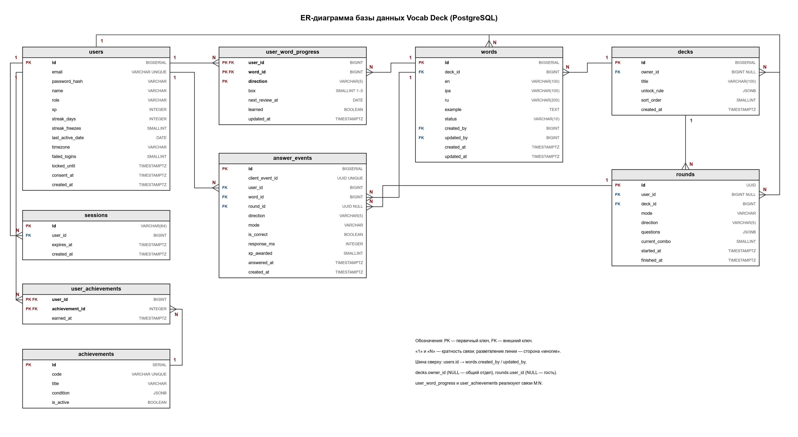

# 2 Проектирование базы данных

СУБД — PostgreSQL. Проектирование выполнено в три этапа: концептуальное, логическое, нормализация.

## 2.1 Концептуальное проектирование

| Сущность | Что хранит | Основные атрибуты |
|---|---|---|
| Пользователь | Учётная запись, игровой прогресс | имя, почта, пароль, роль, опыт, серия дней |
| Сессия | Активный вход пользователя | пользователь, срок действия |
| Колода (отдел) | Набор слов: общий отдел или личный список | владелец, название, условие открытия |
| Слово | Карточка | английское слово, транскрипция, перевод, пример, статус |
| Прогресс по слову | Текущее состояние слова у пользователя | ящик Лейтнера, дата следующего повтора |
| Событие ответа | Журнал всех ответов | слово, режим, верно/неверно, начисленный опыт |
| Раунд | Начатая мини-игра | игрок, отдел, вопросы с правильными ответами, комбо, время начала |
| Достижение | Справочник достижений | код, название, условие |
| Полученное достижение | Какие достижения есть у пользователя | пользователь, достижение, дата |

Гостевой прогресс в БД не хранится: до регистрации он находится в браузере (localStorage) и переносится на сервер при регистрации (UC-03).

## 2.2 Логическое проектирование

### Таблица `users` — пользователи

| Поле | Тип | Ограничения | Описание |
|---|---|---|---|
| id | BIGSERIAL | PK | Идентификатор |
| email | VARCHAR(255) | NOT NULL, UNIQUE | Почта (логин) |
| password_hash | VARCHAR(255) | NOT NULL | Хэш пароля Argon2id (NFR-S-02) |
| name | VARCHAR(100) | NOT NULL | Имя |
| role | VARCHAR(10) | NOT NULL, CHECK (user, admin), DEFAULT user | Роль |
| xp | INTEGER | NOT NULL, DEFAULT 0 | Опыт (кэш, см. 1.3) |
| streak_days | INTEGER | NOT NULL, DEFAULT 0 | Серия дней подряд |
| streak_freezes | SMALLINT | NOT NULL, DEFAULT 0, CHECK 0–2 | Запас заморозок |
| last_active_date | DATE | NULL | Последний день с проверяемым ответом |
| timezone | VARCHAR(50) | NOT NULL, DEFAULT 'Europe/Moscow' | Часовой пояс для подсчёта серии |
| failed_logins | SMALLINT | NOT NULL, DEFAULT 0 | Неудачные попытки входа подряд (NFR-S-04) |
| locked_until | TIMESTAMPTZ | NULL | До какого времени вход заблокирован |
| consent_at | TIMESTAMPTZ | NOT NULL | Согласие на обработку ПДн (NFR-S-08) |
| created_at | TIMESTAMPTZ | NOT NULL, DEFAULT now() | Дата регистрации |

### Таблица `sessions` — сессии

| Поле | Тип | Ограничения | Описание |
|---|---|---|---|
| id | VARCHAR(64) | PK | Случайный токен, передаётся в cookie (NFR-S-03) |
| user_id | BIGINT | FK → users.id, ON DELETE CASCADE | Владелец |
| expires_at | TIMESTAMPTZ | NOT NULL | Срок действия (30 дней) |
| created_at | TIMESTAMPTZ | NOT NULL, DEFAULT now() | Дата входа |

### Таблица `decks` — отделы и личные списки

| Поле | Тип | Ограничения | Описание |
|---|---|---|---|
| id | BIGSERIAL | PK | Идентификатор |
| owner_id | BIGINT | FK → users.id, NULL | NULL — общий отдел, иначе — личный список |
| title | VARCHAR(100) | NOT NULL | Название («Офис», «Переговоры») |
| unlock_rule | JSONB | NULL | Условие открытия, например `{"min_xp": 800}` |
| sort_order | SMALLINT | NOT NULL, DEFAULT 0 | Порядок вывода в кабинете |
| created_at | TIMESTAMPTZ | NOT NULL, DEFAULT now() | Дата создания |

### Таблица `words` — слова

| Поле | Тип | Ограничения | Описание |
|---|---|---|---|
| id | BIGSERIAL | PK | Идентификатор |
| deck_id | BIGINT | FK → decks.id, NOT NULL | Колода |
| en | VARCHAR(100) | NOT NULL, CHECK: латиница, пробел, дефис, апостроф | Английское слово |
| ipa | VARCHAR(100) | NULL | Транскрипция |
| ru | VARCHAR(200) | NOT NULL | Перевод |
| example | TEXT | NULL | Пример предложения |
| status | VARCHAR(10) | NOT NULL, CHECK (draft, published, archived) | Статус публикации |
| created_by | BIGINT | FK → users.id | Автор |
| updated_by | BIGINT | FK → users.id | Кто изменил последним (UC-04) |
| created_at | TIMESTAMPTZ | NOT NULL, DEFAULT now() | Дата создания |
| updated_at | TIMESTAMPTZ | NOT NULL, DEFAULT now() | Дата изменения |

Уникальный индекс `(deck_id, lower(en))` запрещает дубликат слова в отделе (US-12).

### Таблица `user_word_progress` — прогресс по слову

| Поле | Тип | Ограничения | Описание |
|---|---|---|---|
| user_id | BIGINT | PK, FK → users.id | Пользователь |
| word_id | BIGINT | PK, FK → words.id | Слово |
| direction | VARCHAR(5) | PK, CHECK (en_ru, ru_en) | Направление перевода |
| box | SMALLINT | NOT NULL, CHECK 1–5 | Ящик Лейтнера |
| next_review_at | DATE | NOT NULL | Дата следующего повторения |
| learned | BOOLEAN | NOT NULL, DEFAULT false | Слово выучено (верный ответ в ящике 5) |
| updated_at | TIMESTAMPTZ | NOT NULL | Дата последнего изменения |

Составной первичный ключ `(user_id, word_id, direction)`. Индекс `(user_id, next_review_at)` для выборки входящих (NFR-M-02).

### Таблица `answer_events` — журнал ответов

| Поле | Тип | Ограничения | Описание |
|---|---|---|---|
| id | BIGSERIAL | PK | Идентификатор |
| client_event_id | UUID | NOT NULL, UNIQUE | Ключ, сгенерированный клиентом; повторная отправка не дублирует опыт (NFR-R-02) |
| user_id | BIGINT | FK → users.id, NOT NULL | Пользователь |
| word_id | BIGINT | FK → words.id, NOT NULL | Слово |
| direction | VARCHAR(5) | NOT NULL | Направление перевода |
| mode | VARCHAR(20) | NOT NULL, CHECK (deadline, dictation, review, self_check) | Где был дан ответ |
| is_correct | BOOLEAN | NOT NULL | Верный ли ответ |
| response_ms | INTEGER | NULL | Время ответа |
| xp_awarded | SMALLINT | NOT NULL, DEFAULT 0 | Начисленный опыт (по табл. 16 ТЗ) |
| answered_at | TIMESTAMPTZ | NOT NULL | Когда ответ дан на устройстве |
| created_at | TIMESTAMPTZ | NOT NULL, DEFAULT now() | Когда ответ получен сервером |

Индекс `(user_id, created_at)` для статистики за период.

### Таблица `rounds` — раунды мини-игр

| Поле | Тип | Ограничения | Описание |
|---|---|---|---|
| id | UUID | PK | Идентификатор раунда (`round_id` в API) |
| user_id | BIGINT | FK → users.id, NULL | Игрок; NULL — гость |
| deck_id | BIGINT | FK → decks.id, NOT NULL | Отдел |
| mode | VARCHAR(20) | NOT NULL, CHECK (deadline, dictation) | Мини-игра |
| direction | VARCHAR(5) | NOT NULL | Направление перевода |
| questions | JSONB | NOT NULL | Вопросы: word_id, варианты, индекс правильного (клиенту не отдаётся) |
| current_combo | SMALLINT | NOT NULL, DEFAULT 0 | Верных ответов подряд |
| started_at | TIMESTAMPTZ | NOT NULL | Начало (для контроля лимита 60 с) |
| finished_at | TIMESTAMPTZ | NULL | Завершение |

Служебная таблица: незавершённые раунды старше 1 часа удаляются. Поле `answer_events.round_id` (UUID, NULL, FK → rounds.id ON DELETE SET NULL) связывает ответ с раундом.

### Таблица `achievements` — справочник достижений

| Поле | Тип | Ограничения | Описание |
|---|---|---|---|
| id | SERIAL | PK | Идентификатор |
| code | VARCHAR(50) | NOT NULL, UNIQUE | Код («streak_7», «words_100») |
| title | VARCHAR(100) | NOT NULL | Название |
| condition | JSONB | NOT NULL | Условие получения |
| is_active | BOOLEAN | NOT NULL, DEFAULT true | Отключение вместо удаления (CRUDL) |

### Таблица `user_achievements` — полученные достижения

| Поле | Тип | Ограничения | Описание |
|---|---|---|---|
| user_id | BIGINT | PK, FK → users.id | Пользователь |
| achievement_id | INTEGER | PK, FK → achievements.id | Достижение |
| earned_at | TIMESTAMPTZ | NOT NULL, DEFAULT now() | Дата получения |

### Связи

| Связь | Тип | Смысл |
|---|---|---|
| users → sessions | 1:N | У пользователя может быть несколько активных входов |
| users → decks | 1:N | Пользователь владеет личными списками |
| decks → words | 1:N | В колоде много слов |
| users ↔ words через user_word_progress | M:N | Каждый пользователь учит много слов, каждое слово учат многие |
| users → answer_events, words → answer_events | 1:N | Журнал ответов |
| users ↔ achievements через user_achievements | M:N | Связующая таблица |
| users → rounds, decks → rounds | 1:N | Раунды игрока в отделе |
| rounds → answer_events | 1:N | Ответы, данные в раунде |

*ER-диаграмма базы данных*

## 2.3 Нормализация

**1НФ.** Все поля атомарные: нет списков в одной ячейке. Транскрипция, перевод и пример — отдельные поля, а не одна строка «слово — перевод». Исключение — `unlock_rule` и `condition` типа JSONB: это правила, которые система читает целиком и не ищет по их частям.

**2НФ.** Частичных зависимостей нет. В таблицах с составным ключом каждое неключевое поле зависит от всего ключа: `box` в `user_word_progress` определяется только тройкой «пользователь + слово + направление», а `earned_at` — парой «пользователь + достижение».

**3НФ.** Транзитивных зависимостей нет. Название отдела хранится один раз в `decks`, а `words` ссылается на него через `deck_id` (тот же приём, что со справочником «Отдел» в методичке). Название достижения хранится в справочнике `achievements`.

**Осознанная денормализация.** Поля `users.xp`, `streak_days` и `learned` можно вычислить из журнала `answer_events`. Они хранятся отдельно как кэш, чтобы кабинет открывался одним запросом без пересчёта всей истории (NFR-P-01). Источник истины — журнал: при расхождении значения пересчитываются из него.

## 2.4 Зачем разделены `user_word_progress` и `answer_events`

Это две разные таблицы, потому что они отвечают на разные вопросы:

- `user_word_progress` — **текущее состояние**: «в каком ящике слово сейчас и когда его повторять». На одно слово у пользователя одна строка на направление; она обновляется при каждом ответе.
- `answer_events` — **история**: «что происходило». Каждый ответ добавляет новую строку, старые не меняются.

Пример: пользователь ответил на «deadline» 10 раз. В `user_word_progress` по-прежнему одна строка, а в `answer_events` их 10.

Из журнала строятся статистика по дням (US-11), серия дней и проверка «повторный верный ответ в тот же день — 0 опыта» (табл. 16 ТЗ). Из одной таблицы прогресса этого не получить: она хранит только последнее состояние.

## 2.5 Изменения относительно информационной модели из ТЗ (рис. 2 лабы 2)

| Что добавлено | Зачем, требование ТЗ |
|---|---|
| Таблица `rounds`, поле `answer_events.round_id` | Проверка ответов и комбо на сервере при stateless API (NFR-S-05, NFR-M-01) |
| Таблица `sessions` | Сессия в cookie на 30 дней (NFR-S-03); при этом API не хранит состояние в памяти (NFR-M-01) |
| `users.failed_logins`, `locked_until` | Блокировка после 5 неудачных входов (NFR-S-04) |
| `users.timezone` | Серия считается по часовому поясу пользователя (п. 3.8 ТЗ) |
| `users.consent_at` | Согласие на обработку ПДн (NFR-S-08) |
| `answer_events.client_event_id` | Защита от дублей при офлайн-отправке (NFR-R-02) |
| `answer_events.direction` | Прогресс по направлениям считается отдельно |
| `words.updated_by`, `updated_at` | Фиксация автора и даты изменения (UC-04) |
| `words.status` = draft / published / archived | Черновики и архив (US-12–14) |
| `achievements.is_active` | Отключение вместо удаления (CRUDL) |
| Убрано `decks.is_public` | Дублировало `owner_id IS NULL` |
