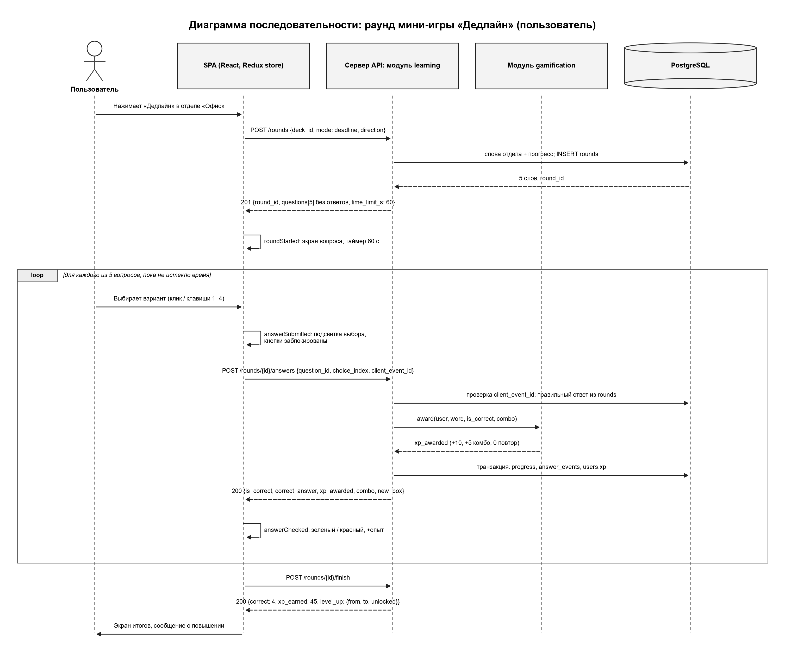
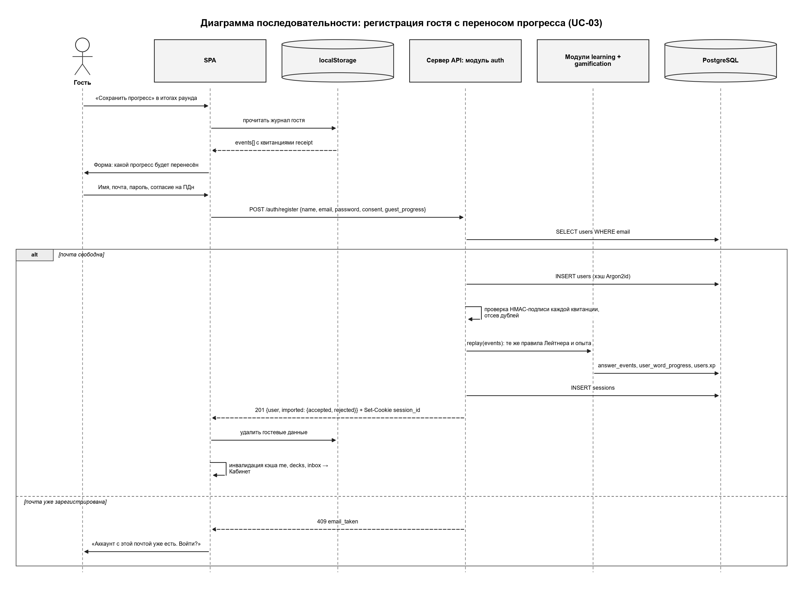
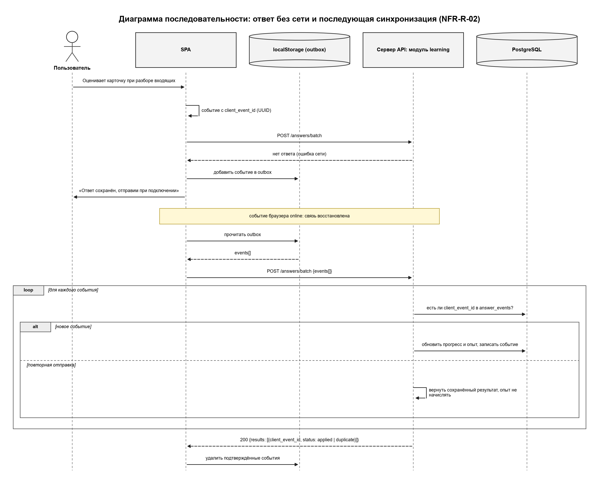

# 3 Проектирование API

API бэкенда Vocab Deck построен в стиле REST: каждый ресурс (пользователь, колода, слово, раунд, ответ) имеет свой URI, действия над ресурсом выражаются HTTP-методами, сервер не хранит состояние клиента между запросами (NFR-M-01). Ниже описаны общие соглашения, сводная таблица эндпоинтов и детальное описание каждого эндпоинта: параметры, тело запроса, ответ и возможные ошибки.

FastAPI автоматически формирует спецификацию OpenAPI 3 по Pydantic-схемам роутеров. Она доступна по адресу `/openapi.json`, интерактивная документация Swagger UI — по адресу `/docs`. В производственной среде `/docs` открыт только для администраторов. Описание в этом разделе — проектное, по нему пишутся Pydantic-схемы.

## 3.1 Общие соглашения

### 3.1.1 Базовый URL и формат данных

| Параметр | Значение |
|---|---|
| Базовый URL | `https://api.vocabdeck.ru/api/v1` (далее в путях префикс `/api/v1` опущен) |
| Протокол | Только HTTPS (NFR-S-01); HTTP-запросы перенаправляются кодом 308 |
| Формат тела | JSON, кодировка UTF-8; исключение — импорт CSV (`multipart/form-data`) |
| Имена полей | snake_case: `next_review_at`, `client_event_id`, `xp_awarded` |
| Дата и время | ISO 8601 в UTC: `2026-10-20T09:15:42Z`; календарные даты — `2026-10-20` |
| Идентификаторы | Целые числа (BIGINT) для сущностей БД; UUID для `client_event_id` и `round_id` |
| Неизвестные поля | Клиент игнорирует неизвестные поля ответа; сервер отклоняет неизвестные поля запроса (422) |

Имена полей в JSON совпадают с именами столбцов БД (раздел 1): `en`, `ipa`, `ru`, `example`, `status`, `box`, `next_review_at`, `learned`, `streak_days`, `streak_freezes`. Поля, которых нет в ответе API, не передаются клиенту никогда: `password_hash`, `failed_logins`, `session.id`.

### 3.1.2 Заголовки запроса

| Заголовок | Когда обязателен | Значение и назначение |
|---|---|---|
| `Content-Type` | Запросы с телом | `application/json` или `multipart/form-data` (импорт) |
| `Cookie` | Запросы пользователя | `session_id=<токен>`; браузер подставляет автоматически |
| `X-Requested-With` | Все изменяющие запросы (POST, PATCH, DELETE) | `VocabDeck`; защита от CSRF. Без заголовка — 403 `csrf_check_failed` |
| `Accept` | Необязателен | `application/json` |

### 3.1.3 Аутентификация и авторизация

Аутентификация — по сессии. При регистрации или входе сервер создаёт запись в таблице `sessions` со случайным токеном (256 бит) и возвращает его в cookie:

```http
Set-Cookie: session_id=Jx9bQ2...kP0; Path=/api; Max-Age=2592000; HttpOnly; Secure; SameSite=Lax
```

- `HttpOnly` — токен недоступен JavaScript, его нельзя украсть через XSS (NFR-S-03).
- `Secure` — cookie передаётся только по HTTPS.
- `SameSite=Lax` вместе с обязательным заголовком `X-Requested-With` защищает от CSRF: чужой сайт не может отправить изменяющий запрос с этим заголовком без разрешения CORS, а CORS разрешён только для origin фронтенда.
- Фронтенд и API размещаются на поддоменах одного домена: `https://app.vocabdeck.ru` и `https://api.vocabdeck.ru`. Для браузера это один «сайт», поэтому cookie с `SameSite=Lax` передаётся в запросах фронтенда к API. Клиент отправляет запросы с `credentials: "include"`, сервер отвечает заголовками CORS `Access-Control-Allow-Origin: https://app.vocabdeck.ru` (не `*`) и `Access-Control-Allow-Credentials: true`; в `Access-Control-Allow-Headers` разрешён `X-Requested-With`.
- Срок сессии — 30 дней (`Max-Age=2592000`). Выход и смена пароля удаляют сессии из БД, поэтому отзыв работает сразу (в отличие от JWT).

Уровни доступа, используемые в таблицах ниже:

| Доступ | Условие | Ошибка при нарушении |
|---|---|---|
| Гость | Запрос без cookie или с любой cookie | — |
| Пользователь | Действующая сессия (role = user или admin) | 401 `unauthorized` |
| Администратор | Действующая сессия и role = admin; проверяется на каждом запросе (NFR-S-07) | 401 без сессии, 403 `forbidden` с сессией пользователя |
| Владелец | Пользователь, которому принадлежит личный список | 404 `not_found` (чужой список не раскрывается) |

### 3.1.4 Формат успешного ответа

Одиночный объект оборачивается в поле `data`:

```json
{
  "data": {
    "id": 101,
    "en": "deadline",
    "ipa": "/ˈdedlaɪn/",
    "ru": "срок, крайний срок",
    "example": "We must meet the deadline by Friday."
  }
}
```

Коллекция — массив в `data` и сведения о пагинации в `meta`:

```json
{
  "data": [
    { "id": 101, "en": "deadline", "ru": "срок, крайний срок" },
    { "id": 103, "en": "colleague", "ru": "коллега" }
  ],
  "meta": { "page": 1, "limit": 20, "total_items": 45 }
}
```

Для небольших непагинируемых коллекций (отделы, должности) `meta` содержит только `total_items`. Ответ 204 No Content тела не имеет.

### 3.1.5 Формат ошибки

Все ошибки возвращаются в едином формате (единый обработчик исключений в модуле `core`):

```json
{
  "error": {
    "code": "validation_failed",
    "message": "Проверьте введённые данные",
    "details": [
      { "field": "email", "message": "Укажите почту в формате name@example.ru" },
      { "field": "password", "message": "Пароль должен содержать не менее 8 символов" }
    ]
  }
}
```

| Поле | Тип | Описание |
|---|---|---|
| `code` | string | Машиночитаемый код ошибки; по нему клиент выбирает реакцию |
| `message` | string | Текст для пользователя на русском языке, объясняет, как исправить ошибку (п. 5.8 ТЗ) |
| `details` | array, необязательное | Ошибки по полям: `field` — путь к полю (`events[3].receipt`), `message` — пояснение; для некоторых кодов — дополнительные данные (`locked_until`, `existing_word_id`) |

Внутренние подробности (трассировка, SQL) клиенту не передаются: при 500 возвращается `{"error": {"code": "internal_error", "message": "Что-то пошло не так. Попробуйте ещё раз"}}`, а подробности пишутся в журнал сервера с идентификатором запроса из заголовка `X-Request-Id`.

### 3.1.6 Коды состояния

| Код | Значение | Пример в Vocab Deck |
|---|---|---|
| 200 OK | Успешное чтение или изменение | `GET /me`, `PATCH /admin/words/101`, ответ на вопрос раунда |
| 201 Created | Ресурс создан | `POST /auth/register`, `POST /decks`, `POST /rounds` |
| 204 No Content | Успех без тела | `POST /auth/logout`, `DELETE /words/512` |
| 400 Bad Request | Запрос не разобран | Невалидный JSON; CSV-файл не в UTF-8 или без строки заголовка |
| 401 Unauthorized | Не выполнен вход или неверные учётные данные | `GET /me` без cookie; неверная почта или пароль при входе |
| 403 Forbidden | Нет прав или функция закрыта | `GET /admin/words` с ролью user; диктант до должности «Младший специалист»; нет `X-Requested-With` |
| 404 Not Found | Ресурс не найден или чужой | `GET /decks/999`; личный список другого пользователя |
| 409 Conflict | Конфликт с текущим состоянием | Почта уже зарегистрирована; слово «deadline» уже есть в отделе «Офис»; раунд завершён |
| 413 Payload Too Large | Слишком большой файл | CSV больше 1 МБ |
| 422 Unprocessable Entity | Ошибка валидации данных | Пароль короче 8 символов; `en` содержит кириллицу; в отделе меньше 4 слов |
| 423 Locked | Вход временно заблокирован | 5 неудачных попыток входа за 15 минут (NFR-S-04) |
| 429 Too Many Requests | Превышен лимит запросов | Более 20 запросов на вход в минуту с одного IP; заголовок `Retry-After` |
| 500 Internal Server Error | Непредвиденная ошибка сервера | Ошибка в коде; клиент повторяет запрос позже |

Код 503 Service Unavailable используется только эндпоинтом `GET /health`, если недоступна БД.

### 3.1.7 Пагинация, фильтрация, поиск

- Пагинация — параметры `page` (с 1, по умолчанию 1) и `limit` (1–100, по умолчанию 20). При `limit > 100` — 422.
- Фильтры — query-параметры с именами полей: `status=draft`, `deck_id=1`, `direction=en_ru`.
- Поиск — параметр `q` (подстрока, без учёта регистра, по полям `en` и `ru`), минимум 2 символа.
- Сортировка по умолчанию указана в описании эндпоинта; параметр сортировки в MVP не вводится (KISS).

Пример: `GET /admin/words?q=dead&deck_id=1&status=draft&page=2&limit=20`.

### 3.1.8 Идемпотентность ответов

Каждый ответ на слово (в раунде, при разборе входящих, при самооценке) клиент снабжает ключом `client_event_id` — UUID v4, сгенерированным на устройстве до отправки. В таблице `answer_events` поле уникально, поэтому:

- повторная отправка того же ответа (обрыв связи, повтор из очереди offline) возвращает **тот же результат**, опыт повторно не начисляется (NFR-R-02);
- в пакетной отправке такой ответ получает статус `duplicate`;
- клиент удаляет ответ из локальной очереди (outbox) только после получения ответа сервера со статусом `applied` или `duplicate`.

### 3.1.9 Гостевой режим и квитанции

Гость играет без учётной записи: сервер проверяет его ответы, но ничего не сохраняет в БД. Вместо этого к каждому проверенному ответу прикладывается квитанция `receipt` — подпись HMAC-SHA256 серверным секретом от канонической строки:

```
v1|<word_id>|<direction>|<mode>|<is_correct>|<answered_at>|<client_event_id>|<combo>
```

Клиент хранит в localStorage журнал событий вместе с квитанциями. При регистрации или входе журнал передаётся в поле `guest_progress`, сервер проверяет подписи и «проигрывает» события через те же правила начисления опыта и ящиков, что и для пользователя. Событие с неверной подписью отбрасывается — подделать опыт гость не может (NFR-S-05). Сервер подписывает `answered_at`, только если оно отличается от серверного времени не более чем на 5 минут; иначе подставляет серверное время.

### 3.1.10 Версионирование

Версия API указывается в URI: `/api/v1/...` (NFR-M-04). Правила:

- **Совместимые изменения** (новый эндпоинт, новое необязательное поле запроса, новое поле ответа) выпускаются в той же версии `v1`.
- **Несовместимые изменения** (удаление или переименование поля, изменение типа, смысла кода ответа) выпускаются как `/api/v2`. Версия `v1` поддерживается не менее 6 месяцев после выхода `v2`, ответы `v1` получают заголовок `Deprecation: true`.
- Формат гостевого журнала в localStorage версионируется отдельно (`format_version`, NFR-R-03).

## 3.2 Сводная таблица эндпоинтов

| Метод | Путь | Назначение | Доступ | Требования |
|---|---|---|---|---|
| **Auth** | | | | |
| POST | `/auth/register` | Регистрация с необязательным переносом прогресса гостя | Гость | US-05, UC-03, NFR-S-02, NFR-S-08 |
| POST | `/auth/login` | Вход, необязательное объединение с прогрессом гостя | Гость | US-06, UC-03 (4б), NFR-S-03, NFR-S-04 |
| POST | `/auth/logout` | Выход, удаление сессии | Пользователь | E4 |
| **Users** | | | | |
| GET | `/me` | Профиль: должность, опыт, серия, заморозки, входящие | Пользователь | US-06, US-07, US-08, US-09 |
| PATCH | `/me` | Изменение имени или пароля | Пользователь | Табл. 14 (CRUDL) |
| DELETE | `/me` | Удаление аккаунта и персональных данных | Пользователь | Табл. 14, NFR-S-08 |
| GET | `/me/stats` | Число ответов по дням за период | Пользователь | US-11 |
| GET | `/me/achievements` | Полученные и доступные достижения | Пользователь | US-11, табл. 14 |
| **Decks** | | | | |
| GET | `/decks` | Отделы и личные списки с прогрессом и условием открытия | Гость | US-01, NFR-O-04, табл. 4 |
| GET | `/decks/{deck_id}` | Колода | Гость (личная — владелец) | US-01 |
| POST | `/decks` | Создание личного списка | Пользователь | E6, табл. 14 |
| PATCH | `/decks/{deck_id}` | Переименование личного списка | Владелец | E6 |
| DELETE | `/decks/{deck_id}` | Удаление личного списка | Владелец | E6 |
| POST | `/decks/{deck_id}/import` | Импорт слов из CSV с отчётом | Владелец | US-10, NFR-S-06, NFR-M-03 |
| **Words** | | | | |
| GET | `/decks/{deck_id}/words` | Слова колоды (пользователям — только опубликованные) | Гость (личная — владелец) | US-01, US-13 |
| POST | `/decks/{deck_id}/words` | Добавление слова в личный список | Владелец | E6 |
| PATCH | `/words/{word_id}` | Изменение слова личного списка | Владелец | E6 |
| DELETE | `/words/{word_id}` | Удаление слова личного списка | Владелец | E6 |
| **Learning** | | | | |
| GET | `/inbox` | Слова, которые пора повторить | Пользователь | US-07, UC-01, NFR-M-02 |
| POST | `/rounds` | Начало раунда мини-игры | Гость | US-04, UC-02 |
| POST | `/rounds/{round_id}/answers` | Ответ на вопрос раунда | Гость | US-04, UC-02, табл. 15, 16, NFR-S-05 |
| POST | `/rounds/{round_id}/finish` | Итоги раунда, повышение | Гость | US-08, UC-02 (6а, 6б) |
| POST | `/answers/batch` | Пакет ответов: самооценка, входящие, offline-очередь | Гость | US-02, UC-01 (6а), NFR-R-02 |
| **Admin** | | | | |
| GET | `/admin/words` | Поиск слов общей колоды с фильтрами | Администратор | US-12–US-14, NFR-S-07 |
| POST | `/admin/words` | Создание слова (черновик или публикация) | Администратор | US-12, UC-04 |
| PATCH | `/admin/words/{word_id}` | Изменение, публикация, архивирование | Администратор | US-13, US-14, UC-04 |
| POST | `/admin/decks` | Создание отдела | Администратор | E7 |
| PATCH | `/admin/decks/{deck_id}` | Изменение отдела, условия открытия | Администратор | E7 |
| GET | `/admin/users` | Поиск пользователя по почте | Администратор | Табл. 14 |
| **Справочники и служебные** | | | | |
| GET | `/levels` | Карьерная лестница | Гость | US-08, табл. 4 |
| GET | `/health` | Проверка доступности | Гость | NFR-R-05 |

Доступ наследуется: эндпоинт с доступом «Гость» доступен и пользователю, и администратору; для вошедшего пользователя ответ дополняется его прогрессом.

## Диаграммы последовательности




*Раунд мини-игры «Дедлайн»*




*Регистрация гостя с переносом прогресса (UC-03)*




*Ответ без сети и последующая синхронизация (NFR-R-02)*

## 3.3 Модуль auth

### 3.3.1 POST /auth/register — регистрация

Создаёт учётную запись, выполняет вход (устанавливает cookie) и, если передан `guest_progress`, переносит прогресс гостя (UC-03). Перенос выполняется в одной транзакции с созданием пользователя.

**Тело запроса**

| Поле | Тип | Обязательное | Ограничения |
|---|---|---|---|
| `name` | string | да | 1–100 символов, без начальных и конечных пробелов |
| `email` | string | да | Формат e-mail, до 255 символов; приводится к нижнему регистру |
| `password` | string | да | 8–128 символов; хранится как хэш Argon2id |
| `consent` | boolean | да | Должно быть `true` — согласие на обработку ПДн (NFR-S-08) |
| `timezone` | string | нет | Имя часового пояса IANA, по умолчанию `Europe/Moscow` |
| `guest_progress` | object | нет | Журнал гостя; если не передан или гость отказался от переноса (UC-03, 3а) — аккаунт с нулевым прогрессом |
| `guest_progress.format_version` | integer | да* | Версия формата журнала, сейчас `1` |
| `guest_progress.events` | array | да* | До 5000 событий, упорядоченных по `answered_at` |
| `events[].client_event_id` | UUID | да | Ключ события |
| `events[].word_id` | integer | да | Слово общей колоды |
| `events[].direction` | string | да | `en_ru` или `ru_en` |
| `events[].mode` | string | да | `deadline`, `dictation`, `review`, `self_check` |
| `events[].is_correct` | boolean | да | Результат проверки |
| `events[].answered_at` | datetime | да | Время ответа |
| `events[].combo` | integer | да | Серия верных ответов в раунде на момент ответа (0 вне раунда) |
| `events[].round_id`, `events[].question_id` | UUID, integer | для ответов раунда | Раунд и вопрос, к которым относится ответ |
| `events[].receipt` | string | да | Квитанция, выданная сервером |

\* — обязательно, если передан `guest_progress`.

```json
{
  "name": "Анна",
  "email": "anna@example.ru",
  "password": "Str0ngPass!",
  "consent": true,
  "timezone": "Europe/Moscow",
  "guest_progress": {
    "format_version": 1,
    "events": [
      {
        "client_event_id": "6f1c2b7e-3a4d-4c1e-9b8a-2d5e7f901a11",
        "word_id": 101,
        "direction": "en_ru",
        "mode": "deadline",
        "is_correct": true,
        "answered_at": "2026-10-20T09:15:42Z",
        "combo": 1,
        "receipt": "Y2Q4ZjNh...Vt9Q"
      },
      {
        "client_event_id": "0b9e4a51-77d2-4f0b-a8c3-5e6f1d2c3b44",
        "word_id": 103,
        "direction": "en_ru",
        "mode": "self_check",
        "is_correct": false,
        "answered_at": "2026-10-20T09:20:03Z",
        "combo": 0,
        "receipt": "pQ7rM1x0...a2Kc"
      }
    ]
  }
}
```

**Обработка журнала.** Сервер проверяет подпись каждого события, отбрасывает события с неверной подписью, по несуществующим словам и дубликаты `client_event_id` (они учитываются в `imported.rejected` с причиной в `rejected_events`), затем проигрывает принятые события в порядке `answered_at`: заполняет `answer_events`, вычисляет ящики (`user_word_progress`), опыт по табл. 16 (в том числе правило «0 за повтор в тот же день»), серию дней и достижения.

**Ответ 201 Created** (+ заголовок `Set-Cookie: session_id=...`)

```json
{
  "data": {
    "user": {
      "id": 42,
      "name": "Анна",
      "email": "anna@example.ru",
      "role": "user",
      "xp": 140,
      "level": { "code": "intern", "title": "Стажёр", "min_xp": 0 },
      "streak_days": 1
    },
    "imported": {
      "accepted": 37,
      "rejected": 1,
      "rejected_events": [
        { "client_event_id": "a2c1e9d4-0f6b-4b2a-8e7c-1d3f5a7b9c20", "reason": "invalid_receipt" }
      ],
      "xp_restored": 140,
      "words_transferred": 12
    }
  }
}
```

После ответа 201 клиент удаляет гостевой журнал из localStorage (US-05).

**Ошибки**

| Код | `error.code` | Когда |
|---|---|---|
| 409 | `email_taken` | Почта уже зарегистрирована. `message`: «Аккаунт с этой почтой уже есть. Войдите, и прогресс будет объединён» (UC-03, 4б) |
| 422 | `validation_failed` | Неверный формат почты, пароль короче 8 символов, `consent` не `true`, неизвестный `format_version` (UC-03, 4а) |
| 429 | `too_many_requests` | Более 5 регистраций в час с одного IP |

Отдельное событие с неверной квитанцией не приводит к ошибке всего запроса: оно попадает в `rejected_events`.

### 3.3.2 POST /auth/login — вход

Проверяет почту и пароль, создаёт сессию. Если передан `guest_progress`, прогресс гостя объединяется с прогрессом аккаунта (UC-03, 4б).

**Тело запроса**

| Поле | Тип | Обязательное | Ограничения |
|---|---|---|---|
| `email` | string | да | До 255 символов |
| `password` | string | да | До 128 символов |
| `guest_progress` | object | нет | Тот же формат, что в `/auth/register` |

```json
{ "email": "anna@example.ru", "password": "Str0ngPass!" }
```

**Правила объединения.** События гостя проигрываются так же, как при регистрации; опыт за слово, на которое в тот же день уже был верный ответ в аккаунте, не начисляется повторно. Ящик по каждому слову и направлению — **больший** из ящика аккаунта и ящика, полученного из гостевого журнала.

**Ответ 200 OK** (+ `Set-Cookie: session_id=...`)

```json
{
  "data": {
    "user": {
      "id": 42, "name": "Анна", "email": "anna@example.ru", "role": "user",
      "xp": 1240,
      "level": { "code": "specialist", "title": "Специалист", "min_xp": 800 },
      "streak_days": 6
    },
    "imported": null
  }
}
```

**Защита от подбора (NFR-S-04).** Каждая неудачная попытка увеличивает `users.failed_logins`. На пятой сервер устанавливает `locked_until = now() + 15 минут` и обнуляет счётчик. Пока блокировка действует, вход отклоняется кодом 423 даже с верным паролем. Успешный вход обнуляет `failed_logins`. Дополнительно действует лимит по IP (slowapi): 20 запросов в минуту.

**Ошибки**

| Код | `error.code` | Когда |
|---|---|---|
| 401 | `invalid_credentials` | Неверная почта **или** пароль. Сообщение общее: «Неверная почта или пароль» — не раскрывает, существует ли аккаунт (US-06). Время ответа одинаково для существующей и несуществующей почты |
| 423 | `account_locked` | Аккаунт заблокирован после 5 неудачных попыток |
| 422 | `validation_failed` | Пустые поля, неверный формат `guest_progress` |
| 429 | `too_many_requests` | Превышен лимит запросов с IP; заголовок `Retry-After` |

```json
{
  "error": {
    "code": "account_locked",
    "message": "Слишком много неудачных попыток. Попробуйте войти через 15 минут",
    "details": [ { "locked_until": "2026-10-20T10:47:00Z" } ]
  }
}
```

Ответ 423 также содержит заголовок `Retry-After: 900`.

### 3.3.3 POST /auth/logout — выход

Удаляет текущую сессию из таблицы `sessions` и возвращает просроченную cookie (`Set-Cookie: session_id=; Max-Age=0`). Тела запроса нет.

- **204 No Content** — выход выполнен. Запрос идемпотентен: без действующей сессии тоже возвращается 204.
- **403** `csrf_check_failed` — нет заголовка `X-Requested-With`.

## 3.4 Модуль users

### 3.4.1 GET /me — профиль текущего пользователя

Возвращает данные для пропуска сотрудника в кабинете одним запросом (NFR-P-01). Значения `xp`, `streak_days` берутся из кэширующих полей таблицы `users`.

**Ответ 200 OK**

```json
{
  "data": {
    "id": 42,
    "name": "Анна",
    "email": "anna@example.ru",
    "role": "user",
    "timezone": "Europe/Moscow",
    "xp": 1240,
    "level": { "code": "specialist", "title": "Специалист", "min_xp": 800 },
    "next_level": { "code": "senior", "title": "Старший специалист", "min_xp": 1600, "xp_left": 360 },
    "streak_days": 6,
    "streak_freezes": 1,
    "inbox_count": 14,
    "features": { "dictation": true, "ru_en": false, "unlimited_lists": false },
    "created_at": "2026-09-01T18:03:11Z"
  }
}
```

`next_level` равен `null` для должности «Директор». Объект `features` показывает функции, открытые по табл. 4, чтобы клиент не дублировал правила.

**Ошибки:** 401 `unauthorized` — нет действующей сессии (клиент показывает гостевой кабинет).

### 3.4.2 PATCH /me — изменение имени или пароля

Передаются только изменяемые поля.

| Поле | Тип | Обязательное | Ограничения |
|---|---|---|---|
| `name` | string | нет | 1–100 символов |
| `current_password` | string | при смене пароля | Текущий пароль |
| `new_password` | string | нет | 8–128 символов |
| `timezone` | string | нет | Имя часового пояса IANA |

```json
{ "current_password": "Str0ngPass!", "new_password": "N3wPassw0rd" }
```

- **200 OK** — обновлённый профиль в формате `GET /me`. При смене пароля все остальные сессии пользователя удаляются, текущая сохраняется.
- **401** `invalid_credentials` — неверный `current_password`.
- **422** `validation_failed` — новый пароль короче 8 символов, пустое имя, неизвестный часовой пояс.

### 3.4.3 DELETE /me — удаление аккаунта

Удаляет учётную запись и персональные данные (имя, почту), сессии, прогресс, журнал ответов, личные списки (NFR-S-08). Слова общей колоды, созданные администратором, сохраняются, поля `created_by`/`updated_by` обнуляются.

```json
{ "password": "Str0ngPass!" }
```

- **204 No Content** — аккаунт удалён, cookie сброшена.
- **401** `invalid_credentials` — неверный пароль (защита от удаления с чужого незаблокированного устройства).
- **409** `last_admin` — попытка удалить последнего администратора.

### 3.4.4 GET /me/stats — статистика по дням

Строится по журналу `answer_events` (индекс `(user_id, created_at)`) с группировкой по календарным дням в часовом поясе пользователя. Учитываются только проверяемые ответы (`deadline`, `dictation`).

**Query-параметры**

| Имя | Тип | Обязательный | Описание |
|---|---|---|---|
| `from` | date | нет | Начало периода; по умолчанию — 6 дней назад |
| `to` | date | нет | Конец периода включительно; по умолчанию — сегодня |

**Ответ 200 OK** — `GET /me/stats?from=2026-10-14&to=2026-10-20`

```json
{
  "data": {
    "from": "2026-10-14",
    "to": "2026-10-20",
    "timezone": "Europe/Moscow",
    "days": [
      { "date": "2026-10-14", "answers": 15, "correct": 12, "xp": 135 },
      { "date": "2026-10-15", "answers": 0, "correct": 0, "xp": 0 },
      { "date": "2026-10-16", "answers": 10, "correct": 9, "xp": 110 }
    ],
    "totals": { "answers": 62, "correct": 51, "xp": 580, "active_days": 5, "learned_words": 23 }
  }
}
```

Массив `days` содержит каждый день периода, в том числе дни без ответов (для графика активности). В примере показаны три дня из семи.

**Ошибки:** 401; 422 `validation_failed` — `from > to` или период длиннее 366 дней.

### 3.4.5 GET /me/achievements — достижения

**Ответ 200 OK**

```json
{
  "data": {
    "earned": [
      { "code": "first_round", "title": "Первый рабочий день", "earned_at": "2026-09-01T18:10:00Z" },
      { "code": "streak_7", "title": "Неделя без прогулов", "earned_at": "2026-09-08T08:02:13Z" }
    ],
    "available": [
      { "code": "words_100", "title": "Сотня слов", "progress": { "current": 23, "target": 100 } },
      { "code": "director", "title": "Директор", "progress": { "current": 1240, "target": 5000 } }
    ]
  }
}
```

В `available` попадают только активные достижения (`achievements.is_active = true`). **Ошибки:** 401.

## 3.5 Модуль decks

### 3.5.1 GET /decks — отделы и личные списки

Возвращает общие отделы (`owner_id IS NULL`) и, для пользователя, его личные списки. Сортировка: сначала отделы по `sort_order`, затем личные списки по дате создания.

**Query-параметры**

| Имя | Тип | Обязательный | Описание |
|---|---|---|---|
| `kind` | string | нет | `shared` — только отделы, `personal` — только личные списки; по умолчанию все |

**Ответ 200 OK** (пользователь с 1240 опыта)

```json
{
  "data": [
    {
      "id": 1, "kind": "shared", "title": "Офис", "sort_order": 1,
      "words_count": 30,
      "progress": { "learned": 12, "in_progress": 15, "new": 3 },
      "locked": false, "unlock_rule": null, "unlock_condition": null
    },
    {
      "id": 2, "kind": "shared", "title": "Переговоры", "sort_order": 2,
      "words_count": 25,
      "progress": { "learned": 3, "in_progress": 8, "new": 14 },
      "locked": false, "unlock_rule": null, "unlock_condition": null
    },
    {
      "id": 3, "kind": "shared", "title": "Командировка", "sort_order": 3,
      "words_count": 28,
      "progress": { "learned": 0, "in_progress": 4, "new": 24 },
      "locked": false,
      "unlock_rule": { "min_xp": 800 },
      "unlock_condition": "Откроется на должности «Специалист» (800 опыта)"
    },
    {
      "id": 4, "kind": "shared", "title": "Собеседование", "sort_order": 4,
      "words_count": 30,
      "progress": { "learned": 0, "in_progress": 0, "new": 30 },
      "locked": true,
      "unlock_rule": { "learned_in_deck": { "deck_id": 1, "count": 20 } },
      "unlock_condition": "Откроется, когда вы выучите 20 слов в отделе «Офис»"
    },
    {
      "id": 57, "kind": "personal", "title": "Слова из отчёта Q3", "sort_order": 0,
      "words_count": 18,
      "progress": { "learned": 0, "in_progress": 6, "new": 12 },
      "locked": false, "unlock_rule": null, "unlock_condition": null
    }
  ],
  "meta": { "total_items": 5 }
}
```

| Поле | Описание |
|---|---|
| `kind` | `shared` — отдел общей колоды, `personal` — личный список (вычисляется из `owner_id`) |
| `words_count` | Число опубликованных слов (`status = published`) |
| `progress` | Слова выученные (`learned`), в ящиках 1–5 (`in_progress`), без прогресса (`new`) по направлению EN→RU |
| `locked` | Закрыт ли отдел для текущего пользователя |
| `unlock_rule` | Условие открытия из `decks.unlock_rule` (машиночитаемое) |
| `unlock_condition` | То же условие текстом для плитки отдела (NFR-O-04) |

**Гость.** Сервер не знает прогресса гостя, поэтому `progress` равен `null`, а `locked` вычисляется для нулевого прогресса. Клиент пересчитывает `locked` по `unlock_rule` и локальному прогрессу.

**Ошибки:** 422 — неизвестное значение `kind`.

### 3.5.2 GET /decks/{deck_id} — колода

**Параметры пути:** `deck_id` (integer, обязательный) — идентификатор колоды.

**Ответ 200 OK** — объект в формате элемента `GET /decks` с дополнительным полем `can_edit` (`true` для владельца личного списка).

**Ошибки:** 404 `not_found` — колоды нет или это чужой личный список.

### 3.5.3 POST /decks — создание личного списка

| Поле | Тип | Обязательное | Ограничения |
|---|---|---|---|
| `title` | string | да | 1–100 символов |

```json
{ "title": "Слова из отчёта Q3" }
```

- **201 Created** — `{"data": {"id": 57, "kind": "personal", "title": "Слова из отчёта Q3", "words_count": 0, ...}}`, заголовок `Location: /api/v1/decks/57`.
- **401** — не выполнен вход; **422** — пустое название.

### 3.5.4 PATCH /decks/{deck_id}, DELETE /decks/{deck_id} — свой личный список

`PATCH` принимает `{"title": "..."}` с теми же ограничениями и возвращает **200** с обновлённой колодой. `DELETE` удаляет список вместе со словами и прогрессом по ним и возвращает **204**; опыт, начисленный ранее, не списывается.

**Ошибки:** 401; 403 `forbidden` — попытка изменить общий отдел (для этого есть `/admin/decks`); 404 — чужой или несуществующий список; 422 — пустое название.

### 3.5.5 POST /decks/{deck_id}/import — импорт CSV

Добавляет слова из CSV-файла в личный список и возвращает отчёт по строкам (US-10).

**Запрос:** `Content-Type: multipart/form-data`, поле формы `file`.

| Требование к файлу | Значение |
|---|---|
| Кодировка | UTF-8 (BOM допускается) |
| Разделитель | Запятая; поля с запятой — в двойных кавычках (RFC 4180) |
| Первая строка | Заголовок; обязательные столбцы `en`, `ru`; необязательные `example`, `ipa`; порядок любой |
| Размер | До 1 МБ и до 5000 строк данных (NFR-M-03) |

Пример файла:

```
en,ru,example
deadline,"срок, крайний срок",We must meet the deadline by Friday.
stakeholder,заинтересованная сторона,Inform all stakeholders about the delay.
negotiate,вести переговоры,
<b>invoice</b>,счёт-фактура,
,отчёт,The report is ready.
Deadline,срок,
```

**Обработка.** Каждая строка проверяется по тем же правилам, что и слово в `POST /decks/{deck_id}/words`. Корректные строки добавляются со статусом `published`. Строки, совпадающие (без учёта регистра) со словом в списке или с более ранней строкой файла, не добавляются. Значения сохраняются как текст; HTML-разметка не исполняется, а экранируется при выводе (NFR-S-06). Все добавления выполняются одной транзакцией.

**Ответ 200 OK** (список уже содержал слово «deadline»)

```json
{
  "data": {
    "total_rows": 6,
    "added": 2,
    "skipped": [
      { "line": 2, "en": "deadline", "reason_code": "duplicate", "reason": "Слово уже есть в списке" },
      { "line": 5, "en": "<b>invoice</b>", "reason_code": "invalid_en", "reason": "Допустимы латинские буквы, пробел, дефис и апостроф" },
      { "line": 6, "en": "", "reason_code": "missing_field", "reason": "Не заполнен столбец en" },
      { "line": 7, "en": "Deadline", "reason_code": "duplicate", "reason": "Слово уже есть в списке" }
    ]
  }
}
```

Номер строки `line` считается от начала файла, строка заголовка — первая. Добавлены `stakeholder` и `negotiate`. Если достигнут лимит размера личного списка (до должности «Руководитель отдела» — 100 слов, табл. 4), оставшиеся строки пропускаются с `reason_code: "limit_reached"`.

**Ошибки**

| Код | `error.code` | Когда |
|---|---|---|
| 400 | `invalid_file` | Файл не в UTF-8, не CSV, нет строки заголовка или столбцов `en`/`ru` |
| 401 | `unauthorized` | Не выполнен вход |
| 403 | `forbidden` | Колода — общий отдел |
| 404 | `not_found` | Чужой или несуществующий список |
| 413 | `file_too_large` | Файл больше 1 МБ или более 5000 строк |

## 3.6 Модуль words

### 3.6.1 GET /decks/{deck_id}/words — слова колоды

Возвращает слова для карточек. Гостям и пользователям выдаются только слова со статусом `published`; черновики и архив видит только администратор (через `/admin/words`). Слова общих отделов доступны для чтения всем; закрытость отдела проверяется при старте раунда.

**Параметры**

| Имя | Где | Тип | Обязательный | Описание |
|---|---|---|---|---|
| `deck_id` | путь | integer | да | Колода |
| `q` | query | string | нет | Поиск по `en` и `ru`, от 2 символов |
| `page` | query | integer | нет | Номер страницы, по умолчанию 1 |
| `limit` | query | integer | нет | 1–100, по умолчанию 20 |

**Ответ 200 OK** (пользователь)

```json
{
  "data": [
    {
      "id": 101,
      "en": "deadline",
      "ipa": "/ˈdedlaɪn/",
      "ru": "срок, крайний срок",
      "example": "We must meet the deadline by Friday.",
      "progress": {
        "en_ru": { "box": 3, "next_review_at": "2026-10-24", "learned": false },
        "ru_en": null
      }
    },
    {
      "id": 103,
      "en": "colleague",
      "ipa": "/ˈkɒliːɡ/",
      "ru": "коллега",
      "example": "My colleague will join the call.",
      "progress": { "en_ru": null, "ru_en": null }
    }
  ],
  "meta": { "page": 1, "limit": 20, "total_items": 30 }
}
```

Для гостя поле `progress` отсутствует. Сортировка — по `en`.

**Ошибки:** 404 — колоды нет или чужой список; 422 — неверные `page`/`limit`.

### 3.6.2 POST /decks/{deck_id}/words — слово в личный список

| Поле | Тип | Обязательное | Ограничения |
|---|---|---|---|
| `en` | string | да | 1–100 символов; латинские буквы, пробел, дефис, апостроф |
| `ru` | string | да | 1–200 символов |
| `ipa` | string | нет | До 100 символов |
| `example` | string | нет | До 500 символов |

```json
{ "en": "stakeholder", "ru": "заинтересованная сторона", "example": "Inform all stakeholders about the delay." }
```

**Ответ 201 Created** — созданное слово (`status: "published"`), заголовок `Location: /api/v1/words/512`.

**Ошибки**

| Код | `error.code` | Когда |
|---|---|---|
| 401 | `unauthorized` | Не выполнен вход |
| 403 | `forbidden` | Колода — общий отдел |
| 403 | `limit_reached` | В списке 100 слов, а должность ниже «Руководителя отдела» |
| 404 | `not_found` | Чужой или несуществующий список |
| 409 | `word_duplicate` | Слово уже есть в списке (без учёта регистра); `details` содержит `existing_word_id` |
| 422 | `validation_failed` | Пустое `en`/`ru`, недопустимые символы в `en` |

### 3.6.3 PATCH /words/{word_id}, DELETE /words/{word_id} — слово личного списка

`PATCH` принимает любое подмножество полей `en`, `ru`, `ipa`, `example` с ограничениями из 3.6.2 и возвращает **200** с обновлённым словом. Прогресс по слову сохраняется. `DELETE` удаляет слово и прогресс по нему, возвращает **204**.

**Ошибки:** 401; 403 `forbidden` — слово общей колоды (изменяется через `/admin/words`); 404 — слово чужого списка или не существует; 409 `word_duplicate` — новое `en` совпадает с другим словом списка; 422 — ошибка валидации.

## 3.7 Модуль learning

### 3.7.1 Правила, применяемые при проверке ответов

Сервер применяет правила ТЗ при каждом ответе (модуль `gamification` вызывается из `learning`):

| Событие | Опыт | Ящик Лейтнера (табл. 15) |
|---|---|---|
| Верный ответ в мини-игре | +10 | Следующий ящик; срок повтора 1/3/7/14/30 дней |
| Серия из 3 и более верных подряд в раунде | +5 за каждый ответ серии, начиная с третьего | — |
| Верный ответ на слово в ящике 5 | +20 дополнительно, `learned = true` | Остаётся в ящике 5 |
| Повторный верный ответ на то же слово в тот же день | 0 (все составляющие) | Не меняется |
| Неверный ответ | 0, серия сбрасывается | Ящик 1, повтор завтра |
| Самооценка на карточке, разбор входящих | 0 | Следующий ящик или ящик 1 |

«Тот же день» определяется по часовому поясу пользователя (`users.timezone`). Ящик меняется только для слов, срок повтора которых наступил, и для новых слов; это не даёт «прогнать» слово через все ящики за один день.

### 3.7.2 GET /inbox — входящие

Возвращает слова, у которых `next_review_at` не позже сегодняшней даты пользователя, кроме архивных (US-07, US-14). Выборка использует индекс `(user_id, next_review_at)` (NFR-M-02). Сортировка: сначала самые просроченные, затем по ящику.

**Query-параметры**

| Имя | Тип | Обязательный | Описание |
|---|---|---|---|
| `direction` | string | нет | `en_ru` или `ru_en`; по умолчанию оба |
| `page`, `limit` | integer | нет | Пагинация, `limit` по умолчанию 20 |

**Ответ 200 OK**

```json
{
  "data": [
    {
      "word_id": 102,
      "en": "negotiate",
      "ipa": "/nɪˈɡəʊʃieɪt/",
      "ru": "вести переговоры",
      "example": "We need to negotiate better terms.",
      "deck": { "id": 2, "title": "Переговоры" },
      "direction": "en_ru",
      "box": 2,
      "next_review_at": "2026-10-20",
      "overdue_days": 0
    }
  ],
  "meta": { "page": 1, "limit": 20, "total_items": 14 }
}
```

Ответы при разборе входящих отправляются через `POST /answers/batch` с `mode: "review"`. Входящие гостя хранятся только на клиенте.

**Ошибки:** 401; 422 — неизвестное значение `direction`.

### 3.7.3 Состояние раунда

Сервер не хранит раунды в памяти процесса (NFR-M-01): состояние раунда записывается в таблицу `rounds`, поэтому любой экземпляр API может обработать любой ответ. При создании раунда в поле `questions` (JSONB) сохраняются вопросы с индексами правильных вариантов — клиенту они не отдаются. Сервер также записывает в `questions` результат ответа на каждый вопрос (`client_event_id`, `is_correct`, `xp_awarded`) и ведёт текущую серию в `current_combo`. Раунды создаются и для гостя (`user_id = NULL`); для пользователя каждый ответ дополнительно пишется в `answer_events` с `round_id`. `round_id` в API — обычный UUID, совпадающий с `rounds.id`. Раунд пользователя доступен только из его сессии, раунд гостя — по `round_id` (UUID v4 практически не угадывается). Незавершённые раунды старше 1 часа удаляются фоновой задачей.

### 3.7.4 POST /rounds — начало раунда

**Тело запроса**

| Поле | Тип | Обязательное | Ограничения |
|---|---|---|---|
| `deck_id` | integer | да | Существующая колода, доступная пользователю |
| `mode` | string | да | `deadline` — выбор из 4 вариантов; `dictation` — «Звонок клиента», ввод слова на слух |
| `direction` | string | нет | `en_ru` (по умолчанию) или `ru_en`; для `dictation` всегда `en_ru` |

```json
{ "deck_id": 1, "mode": "deadline", "direction": "en_ru" }
```

**Подбор вопросов.** 5 слов из опубликованных слов колоды: сначала слова, срок повтора которых наступил, затем новые, затем остальные. Неверные варианты — 3 случайных перевода других слов той же колоды.

**Ответ 201 Created**

```json
{
  "data": {
    "round_id": "3d8f5a2c-91b4-4e7a-b0c2-6a1f9e8d7c55",
    "deck": { "id": 1, "title": "Офис" },
    "mode": "deadline",
    "direction": "en_ru",
    "time_limit_s": 60,
    "started_at": "2026-10-20T09:15:00Z",
    "questions": [
      {
        "question_id": 1,
        "word_id": 101,
        "prompt": "deadline",
        "ipa": "/ˈdedlaɪn/",
        "options": ["коллега", "срок, крайний срок", "счёт-фактура", "совещание"]
      },
      {
        "question_id": 2,
        "word_id": 103,
        "prompt": "colleague",
        "ipa": "/ˈkɒliːɡ/",
        "options": ["коллега", "отчёт", "повестка дня", "срок, крайний срок"]
      }
    ]
  }
}
```

Заголовок ответа: `Location: /api/v1/rounds/3d8f5a2c-91b4-4e7a-b0c2-6a1f9e8d7c55`.

В примере показаны 2 вопроса из 5. Правильный вариант в ответ не включается. Для `dictation` вместо `options` возвращается `speak_text` (слово для синтеза речи в браузере) и `hint_ru` (перевод-подсказка), ответ вводится текстом.

**Ошибки**

| Код | `error.code` | Когда |
|---|---|---|
| 403 | `deck_locked` | Отдел закрыт для пользователя; `message` содержит условие открытия |
| 403 | `feature_locked` | `dictation` до должности «Младший специалист» (300) или `ru_en` до «Старшего специалиста» (1600) |
| 404 | `not_found` | Колоды нет или это чужой личный список |
| 422 | `not_enough_words` | В колоде меньше 4 опубликованных слов (предусловие UC-02) |
| 422 | `validation_failed` | Неизвестный `mode` или `direction` |

Для гостя условия открытия отдела и функций проверяются на клиенте по локальному прогрессу: сервер не знает опыта гостя до переноса.

### 3.7.5 POST /rounds/{round_id}/answers — ответ на вопрос

Проверяет ответ по правильному варианту из `rounds.questions`, начисляет опыт по табл. 16 с учётом `rounds.current_combo`, обновляет ящик по табл. 15 и сохраняет событие в `answer_events` с `round_id` (для пользователя). Перед проверкой сервер убеждается, что раунд не завершён и 60 с с `started_at` не истекли (с допуском 5 с на задержку сети).

**Параметры пути:** `round_id` (UUID, обязательный) — идентификатор раунда из ответа `POST /rounds`.

**Тело запроса**

| Поле | Тип | Обязательное | Ограничения |
|---|---|---|---|
| `question_id` | integer | да | Номер вопроса раунда, 1–5 |
| `choice_index` | integer | для `deadline` | 0–3, индекс в `options` |
| `text` | string | для `dictation` | До 100 символов; сравнение без учёта регистра и лишних пробелов |
| `client_event_id` | UUID | да | Ключ идемпотентности |
| `answered_at` | datetime | да | Время ответа на устройстве |
| `response_ms` | integer | нет | Время ответа, 0–60000 мс |
| `current_box` | integer | нет, только гость | Текущий ящик слова из localStorage (1–5) — для расчёта `new_box` гостю; пользователю игнорируется |

```json
{
  "question_id": 1,
  "choice_index": 1,
  "client_event_id": "6f1c2b7e-3a4d-4c1e-9b8a-2d5e7f901a11",
  "answered_at": "2026-10-20T09:15:42Z",
  "response_ms": 3200
}
```

**Ответ 200 OK — верный ответ, третий подряд** (пользователь)

```json
{
  "data": {
    "question_id": 3,
    "is_correct": true,
    "correct_answer": { "index": 2, "text": "вести переговоры" },
    "xp_awarded": 15,
    "xp_breakdown": [
      { "rule": "correct_answer", "xp": 10 },
      { "rule": "combo", "xp": 5 }
    ],
    "combo": 3,
    "new_box": 3,
    "next_review_at": "2026-10-27",
    "learned": false,
    "xp_total": 1255
  }
}
```

**Ответ 200 OK — неверный ответ**: показывается правильный вариант, слово возвращается в ящик 1 (US-04, UC-02 4а).

```json
{
  "data": {
    "question_id": 4,
    "is_correct": false,
    "correct_answer": { "index": 0, "text": "срок, крайний срок" },
    "xp_awarded": 0,
    "xp_breakdown": [],
    "combo": 0,
    "new_box": 1,
    "next_review_at": "2026-10-21",
    "learned": false,
    "xp_total": 1255
  }
}
```

Другие значения `xp_breakdown.rule`: `learned` (+20 при верном ответе в ящике 5), `repeat_same_day` (0 — слово уже верно названо сегодня, остальные составляющие обнуляются).

**Ответ гостю** дополнительно содержит `receipt` и `xp_provisional: true`; поле `xp_total` отсутствует. Значения опыта для гостя предварительные: правило повтора в тот же день и окончательные ящики применяются при переносе прогресса (3.1.9).

```json
{
  "data": {
    "question_id": 1,
    "is_correct": true,
    "correct_answer": { "index": 1, "text": "срок, крайний срок" },
    "xp_awarded": 10,
    "xp_breakdown": [ { "rule": "correct_answer", "xp": 10 } ],
    "combo": 1,
    "new_box": 2,
    "next_review_at": "2026-10-23",
    "learned": false,
    "xp_provisional": true,
    "receipt": "Y2Q4ZjNh...Vt9Q"
  }
}
```

**Идемпотентность.** Повторная отправка с тем же `client_event_id` возвращает тот же результат с кодом 200 без повторного начисления опыта: результат ответа на вопрос хранится в `rounds.questions` вместе с `client_event_id` (и в `answer_events` для пользователя). Квитанция гостю выдаётся повторно та же.

**Ошибки**

| Код | `error.code` | Когда |
|---|---|---|
| 404 | `not_found` | Раунда нет, он удалён как устаревший или принадлежит другому пользователю |
| 409 | `question_already_answered` | На вопрос уже дан ответ с другим `client_event_id` |
| 409 | `round_expired` | Ответ получен позже `started_at + 60 с` (с допуском 5 с на задержку сети) |
| 409 | `round_finished` | Раунд уже завершён (`finished_at` заполнено) |
| 422 | `validation_failed` | Нет `choice_index` для `deadline`, индекс вне 0–3, неверный UUID |

### 3.7.6 POST /rounds/{round_id}/finish — итоги раунда

Вызывается после 5 вопросов или по истечении 60 с (UC-02, 5а). Записывает `rounds.finished_at`, считает итоги по результатам в `rounds.questions`; для пользователя также пересчитывает серию дней и выдаёт достижения. Тела запроса нет.

**Ответ 200 OK** — повышение в должности (US-08: было 290 опыта, за раунд получено 45)

```json
{
  "data": {
    "round_id": "3d8f5a2c-91b4-4e7a-b0c2-6a1f9e8d7c55",
    "answered": 5,
    "correct": 4,
    "xp_earned": 45,
    "xp_total": 335,
    "level_up": {
      "from": { "code": "intern", "title": "Стажёр", "min_xp": 0 },
      "to": { "code": "junior", "title": "Младший специалист", "min_xp": 300 },
      "unlocked": ["Мини-игра «Звонок клиента» (диктант)"]
    },
    "level": { "code": "junior", "title": "Младший специалист", "min_xp": 300 },
    "next_level": { "code": "specialist", "title": "Специалист", "min_xp": 800, "xp_left": 465 },
    "streak_days": 7,
    "streak_freezes": 1,
    "achievements_earned": [
      { "code": "streak_7", "title": "Неделя без прогулов" }
    ],
    "suggest_registration": false
  }
}
```

`level` — текущая (при повышении — новая) должность, `next_level` — следующая. `level_up` равен `null`, если порог должности не пройден; опыт до раунда вычисляется как `xp_total - xp_earned`. Для гостя `level_up`, `level` и `next_level` равны `null`, `xp_provisional: true`, `suggest_registration: true` (UC-02, 6б); предварительную должность гостя клиент определяет по справочнику `GET /levels`. Повторный вызов возвращает те же итоги.

**Ошибки:** 404 — раунда нет или он принадлежит другому пользователю.

### 3.7.7 POST /answers/batch — пакет ответов

Принимает пакет ответов: самооценку на карточках («помню» / «ещё учить», US-02), разбор входящих (UC-01) и ответы, накопленные без сети (UC-01, 6а; NFR-R-02), в том числе ответы раунда, которые не удалось отправить из-за обрыва связи. Каждый элемент обрабатывается независимо: ошибка в одном не отменяет остальные. Доступен гостю и пользователю.

**Тело запроса**

| Поле | Тип | Обязательное | Ограничения |
|---|---|---|---|
| `answers` | array | да | 1–200 элементов |
| `answers[].client_event_id` | UUID | да | Ключ идемпотентности |
| `answers[].mode` | string | да | `self_check`, `review`, `deadline`, `dictation` |
| `answers[].word_id` | integer | да | Опубликованное слово доступной колоды |
| `answers[].direction` | string | да | `en_ru` или `ru_en` |
| `answers[].is_correct` | boolean | для `self_check`, `review` | `true` — «помню», `false` — «ещё учить» |
| `answers[].round_id` | UUID | для `deadline`, `dictation` | Раунд из `POST /rounds` |
| `answers[].question_id` | integer | для `deadline`, `dictation` | Номер вопроса раунда |
| `answers[].choice_index` / `text` | integer / string | для `deadline` / `dictation` | Как в `POST /rounds/{round_id}/answers` |
| `answers[].answered_at` | datetime | да | Не позже текущего времени сервера и не раньше 30 дней назад |
| `answers[].response_ms` | integer | нет | Время ответа, мс |

**Правила.** Ответы `self_check` и `review` опыта не дают, но меняют ящики. Для ответов раунда (`deadline`, `dictation`) правильность сервер определяет сам по `rounds.questions`, поле `is_correct` клиента не принимается; опыт начисляется по табл. 16 так же, как в `POST /rounds/{round_id}/answers`. Лимит 60 с для таких ответов проверяется по `answered_at` относительно `rounds.started_at`; раунд, удалённый как устаревший (старше 1 часа), даёт `rejected`.

```json
{
  "answers": [
    {
      "client_event_id": "c1a7d0e2-5b3f-4a8e-9d1c-7e2f4b6a8c01",
      "mode": "review", "word_id": 102, "direction": "en_ru",
      "is_correct": true, "answered_at": "2026-10-20T07:41:10Z", "response_ms": 2100
    },
    {
      "client_event_id": "c1a7d0e2-5b3f-4a8e-9d1c-7e2f4b6a8c02",
      "mode": "self_check", "word_id": 101, "direction": "en_ru",
      "is_correct": false, "answered_at": "2026-10-20T07:41:25Z"
    },
    {
      "client_event_id": "c1a7d0e2-5b3f-4a8e-9d1c-7e2f4b6a8c03",
      "mode": "deadline", "word_id": 103, "direction": "en_ru",
      "round_id": "3d8f5a2c-91b4-4e7a-b0c2-6a1f9e8d7c55", "question_id": 5,
      "choice_index": 0, "answered_at": "2026-10-20T09:15:58Z", "response_ms": 2900
    },
    {
      "client_event_id": "c1a7d0e2-5b3f-4a8e-9d1c-7e2f4b6a8c04",
      "mode": "review", "word_id": 9999, "direction": "en_ru",
      "is_correct": true, "answered_at": "2026-10-20T07:41:40Z"
    }
  ]
}
```

**Ответ 200 OK** — результат по каждому `client_event_id` в порядке запроса

```json
{
  "data": {
    "results": [
      {
        "client_event_id": "c1a7d0e2-5b3f-4a8e-9d1c-7e2f4b6a8c01",
        "status": "applied",
        "is_correct": true, "xp_awarded": 0, "new_box": 3, "next_review_at": "2026-10-27"
      },
      {
        "client_event_id": "c1a7d0e2-5b3f-4a8e-9d1c-7e2f4b6a8c02",
        "status": "duplicate",
        "is_correct": false, "xp_awarded": 0, "new_box": 1, "next_review_at": "2026-10-21"
      },
      {
        "client_event_id": "c1a7d0e2-5b3f-4a8e-9d1c-7e2f4b6a8c03",
        "status": "applied",
        "is_correct": true, "correct_answer": { "index": 0, "text": "коллега" },
        "xp_awarded": 10, "combo": 1, "new_box": 2, "next_review_at": "2026-10-23"
      },
      {
        "client_event_id": "c1a7d0e2-5b3f-4a8e-9d1c-7e2f4b6a8c04",
        "status": "rejected",
        "reason_code": "word_not_found",
        "reason": "Слово не найдено или выведено из оборота"
      }
    ],
    "summary": { "applied": 2, "duplicate": 1, "rejected": 1 },
    "xp_total": 1265,
    "inbox_count": 12
  }
}
```

| Статус | Значение | Действие клиента |
|---|---|---|
| `applied` | Ответ проверен, сохранён и применён | Удалить из outbox, обновить ящик |
| `duplicate` | Ответ с этим ключом уже был принят; возвращён прежний результат, опыт повторно не начисляется | Удалить из outbox |
| `rejected` | Ответ отклонён: слово не найдено или в архиве, раунд не найден или истёк, вопрос уже отвечен другим ключом, неверное время | Удалить из outbox, показать слово как недоступное |

Коды `reason_code` для `rejected`: `word_not_found`, `round_not_found`, `round_expired`, `question_already_answered`, `invalid_answered_at`.

**Гость.** Сервер не сохраняет ответы гостя в `answer_events`, но проверяет их (ответы раунда — по `rounds`) и возвращает в каждом элементе со статусом `applied` или `duplicate` поле `receipt`. Так самооценка, разбор входящих и отложенные ответы гостя попадают в журнал для переноса (3.1.9). Ответы раунда гостя распознаются как `duplicate` по `rounds.questions`; для `self_check` и `review` повторная отправка гостя получает статус `applied` с той же квитанцией (подпись детерминирована), а дубликаты отбрасываются при переносе прогресса. Поле `xp_total` гостю не возвращается.

**Ошибки всего запроса:** 422 — пустой массив, более 200 элементов, нарушена структура; 429 — более 30 пакетов в минуту.

## 3.8 Модуль admin

Все эндпоинты модуля требуют роли `admin`; роль проверяется зависимостью FastAPI на каждом запросе по данным из БД, а не по данным клиента (NFR-S-07). С сессией обычного пользователя возвращается 403 `forbidden`.

### 3.8.1 GET /admin/words — поиск слов общей колоды

**Query-параметры**

| Имя | Тип | Обязательный | Описание |
|---|---|---|---|
| `q` | string | нет | Поиск по `en` и `ru`, от 2 символов |
| `deck_id` | integer | нет | Фильтр по отделу |
| `status` | string | нет | `draft`, `published`, `archived`; по умолчанию все |
| `page`, `limit` | integer | нет | Пагинация |

**Ответ 200 OK** — `GET /admin/words?q=nego&deck_id=2`

```json
{
  "data": [
    {
      "id": 102,
      "deck": { "id": 2, "title": "Переговоры" },
      "en": "negotiate",
      "ipa": "/nɪˈɡəʊʃieɪt/",
      "ru": "вести переговоры",
      "example": "We need to negotiate better terms.",
      "status": "published",
      "created_by": { "id": 1, "name": "Администратор" },
      "updated_by": { "id": 1, "name": "Администратор" },
      "created_at": "2026-09-01T10:00:00Z",
      "updated_at": "2026-10-12T14:22:05Z",
      "learners_count": 148
    }
  ],
  "meta": { "page": 1, "limit": 20, "total_items": 1 }
}
```

Сортировка — по `updated_at` убыванию. `learners_count` — число пользователей с прогрессом по слову; помогает оценить последствия изменения.

**Ошибки:** 401; 403; 422 — неверный `status`, короткий `q`.

### 3.8.2 POST /admin/words — создание слова

| Поле | Тип | Обязательное | Ограничения |
|---|---|---|---|
| `deck_id` | integer | да | Общий отдел (`owner_id IS NULL`) |
| `en` | string | да | 1–100 символов; латинские буквы, пробел, дефис, апостроф (UC-04, 4б) |
| `ru` | string | да | 1–200 символов |
| `ipa` | string | нет | До 100 символов |
| `example` | string | нет | До 500 символов |
| `status` | string | нет | `draft` (по умолчанию, US-12) или `published` — публикация сразу (UC-04, 5а) |

```json
{
  "deck_id": 2,
  "en": "counteroffer",
  "ipa": "/ˈkaʊntərˌɒfə/",
  "ru": "встречное предложение",
  "example": "They rejected our counteroffer.",
  "status": "draft"
}
```

**Ответ 201 Created** — созданное слово в формате 3.8.1; `created_by` и `updated_by` — текущий администратор (UC-04).

**Ошибки**

| Код | `error.code` | Когда |
|---|---|---|
| 404 | `not_found` | Отдела `deck_id` нет |
| 409 | `word_duplicate` | Слово уже есть в отделе (уникальный индекс `(deck_id, lower(en))`, US-12, UC-04 4в) |
| 422 | `validation_failed` | Не заполнены `en`, `ru`, `deck_id`; недопустимые символы; `deck_id` — личный список |

```json
{
  "error": {
    "code": "word_duplicate",
    "message": "Слово «deadline» уже есть в отделе «Офис»",
    "details": [
      {
        "field": "en",
        "message": "Слово уже есть в отделе",
        "existing_word_id": 101
      }
    ]
  }
}
```

### 3.8.3 PATCH /admin/words/{word_id} — изменение, публикация, архив

Передаются только изменяемые поля: `deck_id`, `en`, `ipa`, `ru`, `example`, `status`. Ограничения — как в 3.8.2. Сервер записывает `updated_by` и `updated_at`.

Допустимые переходы статуса:

| Из | В | Смысл |
|---|---|---|
| `draft` | `published` | Публикация (US-13): слово появится у пользователей при следующей загрузке колоды |
| `published` | `archived` | Вывод из оборота (US-14) |
| `archived` | `published` | Возврат в оборот |
| `draft` | `archived` | Отказ от черновика |

Пример публикации: `{"status": "published"}`. Пример исправления примера: `{"example": "Please send the report before the deadline."}`.

**Архивирование не ломает прогресс (US-14).** Строки в `user_word_progress` и `answer_events` сохраняются, опыт пользователей не меняется. Архивное слово исключается из подбора вопросов (`POST /rounds`), из входящих (`GET /inbox`) и из списков слов для пользователей. Исправление текста опубликованного слова также не меняет прогресс — он привязан к `word_id`. При возврате в оборот слово появляется во входящих с прежним ящиком.

- **200 OK** — обновлённое слово.
- **404** — слова нет или оно из личного списка.
- **409** `word_duplicate` — новое `en` или новый `deck_id` дают дубликат в отделе.
- **409** `invalid_status_transition` — переход не из таблицы, например `published` → `draft`.
- **422** — ошибка валидации полей.

### 3.8.4 POST /admin/decks, PATCH /admin/decks/{deck_id} — отделы

| Поле | Тип | Обязательное | Ограничения |
|---|---|---|---|
| `title` | string | да для POST | 1–100 символов, уникально среди отделов |
| `unlock_rule` | object или null | нет | `null`, `{"min_xp": <int>}` или `{"learned_in_deck": {"deck_id": <int>, "count": <int>}}` |
| `sort_order` | integer | нет | 0–32767 |

```json
{ "title": "Командировка", "unlock_rule": { "min_xp": 800 }, "sort_order": 3 }
```

Текст `unlock_condition` сервер формирует из `unlock_rule` автоматически. Удаление отделов не предусмотрено: слова отдела архивируются.

- **201 Created** (POST) / **200 OK** (PATCH) — отдел в формате элемента `GET /decks`.
- **404** — отдела нет (PATCH) или `learned_in_deck.deck_id` ссылается на несуществующий отдел.
- **409** `deck_title_taken` — отдел с таким названием уже есть.
- **422** — неизвестный ключ в `unlock_rule`, отрицательный порог.

### 3.8.5 GET /admin/users — поиск пользователя

**Query-параметры:** `email` (string, обязательный, от 3 символов, поиск по подстроке), `page`, `limit`.

```json
{
  "data": [
    {
      "id": 42,
      "name": "Анна",
      "email": "anna@example.ru",
      "role": "user",
      "xp": 1240,
      "level": { "code": "specialist", "title": "Специалист" },
      "locked_until": null,
      "created_at": "2026-09-01T18:03:11Z"
    }
  ],
  "meta": { "page": 1, "limit": 20, "total_items": 1 }
}
```

**Ошибки:** 401; 403; 422 — `email` не передан или короче 3 символов.

## 3.9 Справочники и служебные эндпоинты

### 3.9.1 GET /levels — карьерная лестница

Справочник должностей (табл. 4 ТЗ). Ответ кэшируется (`Cache-Control: public, max-age=3600`).

```json
{
  "data": [
    { "code": "intern",   "title": "Стажёр",              "min_xp": 0,    "unlocks": ["Отделы «Офис» и «Переговоры»"] },
    { "code": "junior",   "title": "Младший специалист",  "min_xp": 300,  "unlocks": ["Мини-игра «Звонок клиента» (диктант)"] },
    { "code": "specialist", "title": "Специалист",        "min_xp": 800,  "unlocks": ["Отдел «Командировка»"] },
    { "code": "senior",   "title": "Старший специалист",  "min_xp": 1600, "unlocks": ["Режим RU→EN во всех отделах"] },
    { "code": "head",     "title": "Руководитель отдела", "min_xp": 3000, "unlocks": ["Личные списки без ограничения размера"] },
    { "code": "director", "title": "Директор",            "min_xp": 5000, "unlocks": ["Итоговое достижение"] }
  ],
  "meta": { "total_items": 6 }
}
```

### 3.9.2 GET /health — проверка доступности

Используется внешним мониторингом доступности (NFR-R-05) и проверкой готовности контейнера на PaaS. Аутентификация не требуется, запрос выполняет `SELECT 1` к БД.

- **200 OK** — `{"data": {"status": "ok", "db": "ok", "version": "1.0.0"}}`
- **503 Service Unavailable** — `{"error": {"code": "db_unavailable", "message": "База данных недоступна"}}`

## 3.10 Пример полного цикла: гость играет раунд и регистрируется с переносом прогресса

Сценарий объединяет UC-02 и UC-03. Гость открывает приложение без входа, проходит раунд «Дедлайн» в отделе «Офис» и сохраняет прогресс в аккаунте.

| № | Запрос | Ответ | Что происходит |
|---|---|---|---|
| 1 | `GET /me` | 401 `unauthorized` | Сессии нет — клиент показывает гостевой кабинет |
| 2 | `GET /decks` | 200 | Отделы; «Офис» и «Переговоры» открыты, «Командировка» с `unlock_condition` |
| 3 | `GET /decks/1/words?limit=30` | 200 | Слова отдела «Офис» для карточек |
| 4 | `POST /answers/batch` (`self_check`, «deadline» — «ещё учить») | 200, `applied` + `receipt` | Слово в ящике 1; событие с квитанцией — в журнал localStorage (US-02) |
| 5 | `POST /rounds` `{"deck_id": 1, "mode": "deadline"}` | 201 | `round_id`, 5 вопросов, `time_limit_s: 60`; раунд записан в `rounds` с `user_id = NULL` |
| 6 | `POST /rounds/{round_id}/answers` (вопрос 1, верно) | 200 | `xp_awarded: 10`, `combo: 1`, `new_box: 2`, `receipt` |
| 7 | `POST /rounds/{round_id}/answers` (вопрос 2, верно) | 200 | `xp_awarded: 10`, `combo: 2` |
| 8 | `POST /rounds/{round_id}/answers` (вопрос 3, верно) | 200 | `xp_awarded: 15` (10 + 5 за серию), `combo: 3` |
| 9 | `POST /rounds/{round_id}/answers` (вопрос 4, ошибка) | 200 | `is_correct: false`, `correct_answer`, `new_box: 1`, `combo: 0` |
| 10 | `POST /rounds/{round_id}/answers` (вопрос 4, повтор из-за обрыва связи, тот же `client_event_id`) | 200 | Тот же результат, опыт не удваивается |
| 11 | `POST /rounds/{round_id}/answers` (вопрос 5, верно) | 200 | `xp_awarded: 10`, `combo: 1` |
| 12 | `POST /rounds/{round_id}/finish` | 200 | `correct: 4`, `xp_earned: 45`, `xp_provisional: true`, `suggest_registration: true` |
| 13 | `POST /auth/register` с почтой, уже занятой | 409 `email_taken` | Клиент предлагает войти (UC-03, 4б) |
| 14 | `POST /auth/register` с новой почтой, `consent: true`, `guest_progress` (6 событий) | 201 + `Set-Cookie` | Подписи проверены, события проиграны: `imported.accepted: 6`, `imported.rejected: 0`; клиент очищает журнал |
| 15 | `GET /me` | 200 | `xp: 45`, должность «Стажёр», `streak_days: 1`, `inbox_count: 0` |
| 16 | `GET /decks` | 200 | Отделы с прогрессом пользователя (`progress.in_progress: 5`) |

Все изменяющие запросы (4–14) содержат заголовок `X-Requested-With: VocabDeck`; запросы 15–16 и далее передают cookie `session_id`. Если на шаге 14 гость передаст событие с изменённым `is_correct`, подпись не совпадёт, событие попадёт в `rejected_events`, а опыт за него не будет начислен.
