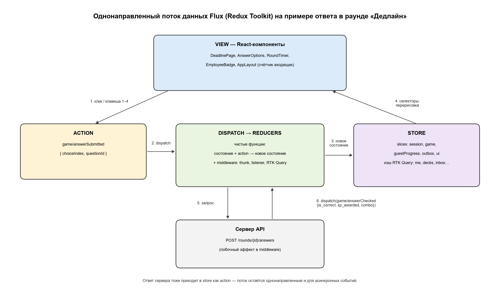
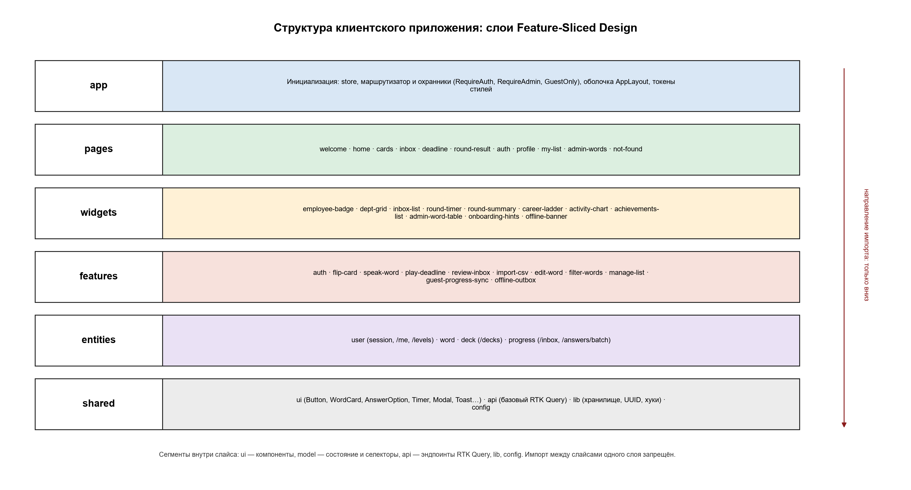

# 4 Архитектура пользовательской части

Пользовательская часть (front-end) Vocab Deck — это клиент в трёхуровневой архитектуре «браузер → REST API → PostgreSQL». Клиент показывает интерфейс, принимает действия пользователя и передаёт на сервер только ответы. Опыт, должность, ящики Лейтнера и серию дней вычисляет сервер (NFR-S-05). Исключение — гость: его прогресс до регистрации хранится в браузере как журнал событий с подписанными сервером квитанциями `receipt`.

Раздел опирается на ТЗ (ЛР2: экраны — раздел 6, навигация — 5.6, UI-kit — табл. 25, нефункциональные требования — табл. 17–20) и на кликабельный прототип `Vocab-deck/index.html`.

## 4.1 Тип приложения и стек

### 4.1.1 Выбор типа приложения: SPA

Клиент — одностраничное приложение (Single Page Application). HTML-оболочка и пакет JS/CSS загружаются один раз. Дальше экраны переключаются в браузере, а с сервером клиент обменивается только JSON через REST API.

| Критерий | MPA (многостраничное) | SSR (React + Next.js) | SPA (выбрано) |
|---|---|---|---|
| Реакция на действие в мини-игре | Перезагрузка страницы на каждый ответ, таймер сбивается | Быстро после гидратации, но нужен Node-сервер | Мгновенно: экран меняется без запроса HTML, таймер работает непрерывно |
| Требование NFR-P-02 (реакция ≤ 100 мс) | Не выполняется | Выполняется | Выполняется |
| Офлайн-работа (NFR-R-02, UC-01 6а) | Невозможна: без сети нет страницы | Частично | Возможна: приложение уже загружено, ответы копятся в очереди |
| SEO | Хорошее | Хорошее | Слабое, но индексировать нужно только страницу приветствия |
| Хостинг | Сервер шаблонов | Отдельный Node-сервер | Статические файлы на CDN / GitHub Pages |
| Сложность для одного разработчика | Средняя | Высокая (два рантайма, гидратация) | Низкая |

Почему SPA:

1. Основной сценарий — игра на время: 5 вопросов, таймер на 60 с, подсветка ответа, комбо. Перезагрузка страницы на каждый ответ сбрасывала бы таймер и превышала 100 мс.
2. Почти все экраны (кабинет, входящие, профиль, игра, админка) показывают личные данные, и поисковикам они не нужны. Индексировать нужно только страницу приветствия. Её статический HTML **пререндерится на этапе сборки**, а дальше её «оживляет» тот же SPA-пакет. Сервер для SSR при этом не нужен.
3. Это подход **JAMstack**: JavaScript в браузере + API + заранее собранная разметка. Фронтенд — набор статических файлов на GitHub Pages / CDN, бэкенд — отдельный контейнер с REST API. Фронтенд и бэкенд развёртываются независимо.

Ограничения хостинга и как они решаются:

- **Маршруты SPA на GitHub Pages.** У GitHub Pages нет правил перезаписи URL. Поэтому при сборке рядом с `index.html` кладётся его копия `404.html`: при прямом заходе на `/profile` браузер получает оболочку приложения, а маршрут выбирает React Router.
- **Cookie сессии.** Cookie `session_id` имеет атрибут `SameSite=Lax`, поэтому браузер отправляет её только запросам к тому же сайту. Значит, фронтенд и API должны жить на поддоменах одного домена (например, `app.<домен>` и `api.<домен>`). На стандартных доменах `*.github.io` и `*.onrender.com` cookie не передавалась бы. Клиент отправляет запросы с учётными данными (credentials: include), а сервер разрешает CORS только для origin фронтенда.

### 4.1.2 Стек технологий

| Технология | Роль | Почему выбрана |
|---|---|---|
| React 18 | Библиотека UI-компонентов | Декларативная отрисовка: интерфейс — функция от состояния, ровно как `render()` в прототипе, только без ручной сборки HTML-строк. Виртуальный DOM обновляет только изменившиеся узлы, поэтому фокус и позиция курсора не теряются. В прототипе для этого понадобился обходной путь: после перерисовки фокус в поле поиска возвращается вручную. Большая экосистема, `React.lazy` и `Suspense` для разделения кода |
| TypeScript | Статическая типизация | Типы DTO API (`Word`, `Deck`, `AnswerResult`, `Receipt`) описаны один раз и проверяются при сборке. Ошибки в именах полей snake_case ловятся до запуска. Типизированные actions и состояние store |
| Vite | Сборщик и dev-сервер | Быстрый запуск и горячая перезагрузка. Продакшен-сборка через Rollup с разделением на чанки по динамическим импортам и отчётом о размере (проверка NFR-P-04) |
| Redux Toolkit | Реализация паттерна Flux | Единый store, slices (reducer + action creators в одном месте), неизменяемые обновления через Immer, listener middleware для побочных эффектов. Минимум шаблонного кода по сравнению с «классическим» Redux |
| RTK Query | Серверное состояние | Кэш ответов API, флаги загрузки и ошибок, повтор запросов, инвалидация по тегам. Входит в Redux Toolkit: отдельная библиотека (React Query, SWR) не нужна, а кэш виден в том же Redux DevTools |
| React Router 6 | Маршрутизация | Маршруты как дерево компонентов, вложенные маршруты (модальное окно редактирования поверх списка слов), ленивая загрузка страниц, защищённые маршруты-обёртки |
| CSS Modules + CSS-переменные | Стили | Токены дизайн-системы ЛР2 (табл. 23: `--desk`, `--paper`, `--ink`, `--ink-soft`, `--ink-blue`, `--sage-deep`, `--amber-deep`, `--red`; отступы, кратные 4 px; радиусы) задаются один раз в `:root`. CSS Modules изолируют классы компонентов без runtime-затрат, которые есть у CSS-in-JS. Медиа-запросы `prefers-reduced-motion` и брейкпоинты остаются чистым CSS |
| Web Speech API (`speechSynthesis`) | Озвучка слов (US-03) | Встроен в браузер: ни сервера синтеза, ни аудиофайлов не нужно. Если API недоступен, кнопка озвучки неактивна и показывается пояснение |
| Шрифты Inter и Caveat (WOFF2) | Типографика (табл. 24) | Отдельные файлы с `font-display: swap` и подмножеством символов (латиница, кириллица, IPA). В прототипе шрифты вшиты в CSS в base64, и это раздувает CSS. В целевой версии они грузятся отдельными кэшируемыми файлами |

### 4.1.3 Бюджет размера (NFR-P-04: не более 300 КБ JS + CSS в сжатом виде при первой загрузке)

| Мера | Что даёт |
|---|---|
| Разделение кода по маршрутам | Каждая страница — отдельный чанк, загружается через `React.lazy` при первом переходе. Пока чанк грузится, показывается скелетон экрана |
| Админка — отдельный чанк | Страница «Слова» и модальное окно редактирования попадают в отдельный чанк, который загружается только при роли `admin`. Обычный пользователь его не скачивает |
| Предзагрузка вероятного следующего экрана | При наведении или фокусе на плитку отдела фоном подгружается чанк мини-игры, поэтому переход ощущается мгновенным |
| Без тяжёлых зависимостей | График активности за неделю (7 столбцов) рисуется своим компонентом на CSS/SVG, без библиотеки графиков. Даты форматируются через встроенный `Intl` |
| Контроль в CI | Сборка падает, если стартовый набор чанков превышает бюджет (по отчёту сборщика) |

Ориентировочный стартовый набор: React + ReactDOM, Redux Toolkit с RTK Query, React Router, оболочка приложения и страница кабинета — около 120–150 КБ в gzip. Запас до лимита остаётся на рост функциональности.

## 4.2 Выбор паттерна проектирования интерфейса

### 4.2.1 Требования приложения к паттерну

1. **Многие экраны используют одни и те же данные.** Опыт и должность видны на пропуске в кабинете, в итогах раунда и на карьерной лестнице в профиле. Счётчик входящих — в боковом меню и в нижней панели вкладок. Признак «гость» меняет меню, итоги раунда и профиль. После раунда все эти места должны обновиться согласованно.
2. **Много асинхронных событий.** Ответ сервера на выбор варианта, тик таймера, истечение времени, потеря и восстановление сети, отправка очереди ответов.
3. **Важна предсказуемость.** Начисление опыта и повышение должности — заметные для пользователя события. Ошибку вида «опыт показан дважды» нужно уметь воспроизвести и отладить.
4. **Один разработчик**: решение должно быть простым и хорошо документированным.

### 4.2.2 Сравнение паттернов

| Критерий | MVC | MVP | MVVM | Flux (выбрано) |
|---|---|---|---|---|
| Идея | Контроллер принимает ввод и меняет модель, представление читает модель | Presenter — посредник между пассивным View и моделью, вызывает методы View | ViewModel хранит состояние экрана, View связан с ним двусторонней привязкой | Однонаправленный поток: View → Action → Dispatcher/Reducer → Store → View |
| Направление данных | Двустороннее, связи модель ↔ представление часто многие-ко-многим | Двустороннее через Presenter | Двустороннее (data binding) | Строго одностороннее |
| Общие данные многих экранов (xp, должность, входящие) | Несколько моделей уведомляют несколько представлений, каскадные обновления трудно отследить | У каждого Presenter своя копия, синхронизировать нужно вручную | ViewModel привязаны к экрану, общие данные нужно выносить в сервисы | Единый Store: каждый экран подписан на свой срез, данные лежат в одном месте |
| Асинхронные события (сервер, таймер, сеть) | Обработчики разбросаны по контроллерам | Логика в Presenter, но порядок событий неявный | Изменения свойств неявно запускают другие изменения | Каждое событие — отдельный action в журнале, порядок явный |
| Отладка | Логи вручную | Логи вручную | Сложно: изменение свойства запускает цепочку привязок | Redux DevTools: журнал всех actions, состояние до и после, «перемотка времени» |
| Тестирование | Контроллер зависит от View и модели | Presenter тестируется с заглушкой View | ViewModel тестируется отдельно | Reducer — чистая функция: состояние + action → новое состояние, тест без браузера |
| Соответствие React | Нет готовой поддержки | Нет готовой поддержки | Естественно для Vue/Angular/Knockout, в React — через MobX | Родной для React: Redux Toolkit — стандартное решение |
| Объём шаблонного кода | Средний | Высокий (интерфейсы View) | Низкий | Низкий с Redux Toolkit (slices) |

### 4.2.3 Обоснование выбора Flux

- **Единый источник состояния.** Опыт, должность, серия и число входящих лежат в одном месте (кэш `GET /me` в store). Пропуск, меню, итоги и профиль читают одно значение и не могут разойтись.
- **Предсказуемость.** Состояние меняется только через action и reducer. Например, опыт за раунд растёт только в обработчике `game/answerChecked`, то есть только после ответа сервера. Других путей изменить опыт в коде нет.
- **Отладка.** В режиме разработки подключён Redux DevTools. Можно пошагово воспроизвести раунд: `roundStarted` → `answerSubmitted` → `answerChecked` → … → `roundFinished` — и увидеть состояние после каждого шага. В продакшен-сборке DevTools отключены.
- **Связь с прототипом.** Прототип ЛР2 написан на чистом JavaScript, но фактически уже устроен по Flux (табл. 4.1). Целевая архитектура не переписывает его логику, а формализует её и убирает отступления от однонаправленного потока.

Таблица 4.1 — Элементы Flux в прототипе и в целевой архитектуре

| Элемент Flux | В прототипе `index.html` | В целевой архитектуре |
|---|---|---|
| Store | Единый объект состояния `S` (роль, экран, xp, серия, флип карточки, текущая игра `S.game`, модальное окно, тост, фильтры) | Redux store: slices `session`, `game`, `guestProgress`, `outbox`, `ui` и кэш RTK Query `api` |
| Action | Атрибуты `data-go`, `data-act`, `data-opt`, `data-edit` у кнопок, один делегированный обработчик кликов | Типизированные объекты-действия (`game/answerSubmitted` и др.), создаются action creators из slices |
| Dispatcher + Reducer | Функции-действия `go()`, `pick()`, `startGame()`, `finishGame()`, `setRole()` меняют `S` | `dispatch` передаёт action в reducers, reducers — чистые функции. Побочные эффекты (запросы, таймеры, localStorage) — в thunks и listener middleware |
| View | `render()` целиком перерисовывает экран из `S` через объект `screens` | React-компоненты подписаны на нужные срезы store через селекторы и перерисовываются только при их изменении |

Нарушения однонаправленного потока в прототипе, которые устраняет целевая архитектура:

1. Таймер раунда меняет DOM напрямую (ширину шкалы, класс `low`, текст «осталось N с»), минуя `render()`. В целевой версии оставшееся время вычисляется из `endsAt` в store, а виджет таймера только отображает его.
2. Флип карточки переключает класс у DOM-элемента и одновременно пишет `S.flip`, то есть состояние хранится в двух местах. В целевой версии флип — локальное состояние компонента карточки, а DOM строится из него.
3. Начисление опыта (`+10`, `+5` за серию) считается в браузере в `pick()`. По NFR-S-05 это делает сервер, а клиент только показывает присланные значения.
4. Полная перерисовка через `innerHTML` сбрасывает фокус. Для поля поиска в прототипе фокус восстанавливается вручную. В React это не нужно.

### 4.2.4 Схема потока Flux в терминах приложения



*Однонаправленный поток данных Flux на примере ответа в раунде «Дедлайн»*


В Redux роль Dispatcher выполняет функция `dispatch` store вместе с цепочкой middleware. Reducers — это обработчики, которые регистрируются в классическом Flux-диспетчере. Ответ сервера тоже приходит в store как action, поэтому поток остаётся однонаправленным и для асинхронных событий.

### 4.2.5 Перечень основных actions

| Action | Кто инициирует | Что меняется в состоянии |
|---|---|---|
| `session/resolved` | Ответ `GET /me` при старте (200 или 401) | Статус сессии: `guest` или `authenticated`, роль |
| `session/loggedOut` | Кнопка «Выйти», ответ 401 на защищённый запрос | Сессия сброшена, кэш API очищен |
| `game/roundRequested` | Кнопка «Дедлайн» на плитке отдела | `game.status = loading` |
| `game/roundStarted` | Ответ `POST /rounds` | Вопросы, `roundId`, `index = 0`, `endsAt`, комбо 0, опыт раунда 0 |
| `game/answerSubmitted` | Клик по варианту или клавиша 1–4 | Выбранный вариант, `status = checking`, варианты заблокированы |
| `game/answerChecked` | Ответ `POST /rounds/{id}/answers` | Верно/неверно, правильный ответ, `xp_awarded` добавлен к опыту раунда, комбо, счётчик верных |
| `game/answerDeferred` | Сеть недоступна при ответе | Ответ помечен «проверим позже», элемент добавлен в outbox |
| `game/nextQuestion` | Пауза 0,9 с после проверки | `index + 1`, выбор сброшен |
| `game/timeExpired` | Виджет таймера дошёл до 0 | `status = finishing` |
| `game/roundFinished` | Ответ `POST /rounds/{id}/finish` | Итоги: верных, всего, опыт, данные о повышении |
| `game/levelUp` | `roundFinished` с `level_up = true` | Новая должность для блока «Повышение!» |
| `game/roundAbandoned` | Уход со страницы игры | Состояние раунда очищено |
| `review/wordFlipped` | Клик, Enter или Пробел по карточке | Локальное состояние карточки (не в store) |
| `review/selfAssessed` | Кнопки «Помню» / «Ещё учить» | Ответ в очереди на отправку, переход к следующей карточке |
| `guestProgress/eventRecorded` | Ответ сервера гостю с `receipt` | Событие с квитанцией добавлено в журнал |
| `guestProgress/cleared` | Успешная регистрация или вход | Журнал очищен |
| `outbox/enqueued` | Ответ не отправлен (нет сети, 5xx) | Элемент добавлен в очередь |
| `outbox/flushStarted`, `outbox/itemsAcked`, `outbox/flushFailed` | Восстановление сети, старт приложения | Очередь отправляется и очищается, либо растёт счётчик попыток |
| `ui/toastShown`, `ui/toastHidden` | Любая операция с подтверждением | Очередь уведомлений |
| `ui/networkChanged` | События браузера `online` / `offline` | Признак офлайн-режима, баннер |
| `ui/registerPromptShown` | Итоги первого раунда гостя | Флаг «предложение показано в этой сессии» (NFR-O-03) |
| `ui/onboardingStepChanged`, `ui/onboardingSkipped` | Подсказки первого запуска | Шаг подсказки, не больше 3 (NFR-O-02) |

## 4.3 Структура модулей (Feature-Sliced Design)

### 4.3.1 Слои

Код организован по методологии Feature-Sliced Design (FSD). Модули разделены на слои по уровню ответственности. Внутри слоя код делится на слайсы по предметной области. Внутри слайса — сегменты: `ui` (компоненты), `model` (состояние Redux, селекторы, thunks), `api` (эндпоинты RTK Query), `lib` (вспомогательные функции), `config`.

| Слой | Назначение | Примеры в Vocab Deck |
|---|---|---|
| `app` | Инициализация приложения: провайдеры, store, маршрутизатор, глобальные стили и токены | Store с middleware, дерево маршрутов и охранники доступа, `tokens.css` |
| `pages` | Экраны целиком. Страница собирает виджеты и фичи и привязана к маршруту | Кабинет, Карточки, Дедлайн, Итоги, Профиль, Управление словами |
| `widgets` | Крупные самостоятельные блоки экрана из нескольких фич и сущностей | Пропуск сотрудника, сетка отделов, карьерная лестница, таблица слов админа |
| `features` | Действия пользователя, которые дают ему ценность | Перевернуть карточку, озвучить слово, ответить в «Дедлайне», импортировать CSV |
| `entities` | Бизнес-сущности: типы, запросы к API, простое отображение | Пользователь, слово, колода, прогресс по слову |
| `shared` | Переиспользуемый код без бизнес-смысла | UI-kit, базовый API-клиент, адаптер хранилища, хуки, конфигурация |



*Слои клиентского приложения (Feature-Sliced Design)*


**Правило зависимостей.** Модуль может импортировать только из слоёв ниже себя: `app → pages → widgets → features → entities → shared`. Импорт вверх (например, из `entities` в `features`) и импорт между слайсами одного слоя запрещены. Например, `features/play-deadline` не импортирует `features/speak-word`: обе фичи объединяет страница или виджет. Каждый слайс открывает наружу только публичный API (файл `index.ts`), импорт внутренних файлов чужого слайса запрещён. Правила проверяются линтером (ESLint с правилами границ импорта).

Эндпоинты API распределены по слайсам. В `shared/api` создаётся один базовый RTK Query API (адрес, заголовки, обработка ошибок, перечень тегов). Каждый слайс `entities` и `features` добавляет к нему свои эндпоинты через механизм внедрения (injectEndpoints). Так кэш остаётся единым, а код запросов лежит рядом с сущностью.

### 4.3.2 Дерево каталогов

```
src/
├── app/
│   ├── providers/            — провайдер store, маршрутизатор, граница ошибок (ErrorBoundary)
│   ├── store/                — сборка store: reducers слайсов, RTK Query, listener middleware
│   ├── router/               — дерево маршрутов, ленивые страницы, охранники доступа
│   │   └── guards/           — RequireAuth, RequireAdmin, GuestOnly
│   ├── layout/               — оболочка: боковое меню / нижняя панель вкладок, область контента
│   └── styles/               — tokens.css (цвета, отступы, радиусы ЛР2), fonts.css, reset.css
│
├── pages/
│   ├── welcome/              — Приветствие (пререндерится при сборке)
│   ├── home/                 — Кабинет
│   ├── cards/                — Карточки отдела (тренировка без очков)
│   ├── inbox/                — Входящие: разбор слов на повторение
│   ├── deadline/             — Мини-игра «Дедлайн»
│   ├── round-result/         — Итоги раунда
│   ├── auth/                 — Вход и Регистрация (две вкладки одного экрана)
│   ├── profile/              — Профиль
│   ├── my-list/              — Личный список слов (просмотр, добавление, импорт)
│   ├── admin-words/          — Управление словами (отдельный чанк)
│   └── not-found/            — Страница 404
│
├── widgets/
│   ├── employee-badge/       — Пропуск сотрудника: должность, шкала опыта, серия
│   ├── dept-grid/            — Сетка плиток отделов и личных списков
│   ├── inbox-list/           — Блок «Входящие на сегодня» и список слов к повторению
│   ├── round-timer/          — Шкала оставшегося времени раунда
│   ├── round-summary/        — Итоги: счёт, опыт, повышение, предложение сохранить прогресс
│   ├── career-ladder/        — Карьерная лестница (табл. 4 ТЗ)
│   ├── activity-chart/       — График проверенных слов за неделю
│   ├── achievements-list/    — Полученные и доступные достижения
│   ├── admin-word-table/     — Таблица (компьютер) / карточки (телефон) слов общей колоды
│   ├── onboarding-hints/     — Подсказки первого запуска (до 3 шагов, можно пропустить)
│   └── offline-banner/       — Плашка «Нет соединения, ответы сохранены на устройстве»
│
├── features/
│   ├── auth/                 — формы входа и регистрации, выход; согласие на ПДн
│   ├── flip-card/            — переворот карточки (клик, Enter, Пробел), анимация 0,5 с
│   ├── speak-word/           — кнопка озвучки на Web Speech API, проверка доступности
│   ├── play-deadline/        — slice game, варианты ответа, клавиши 1–4, thunks раунда
│   ├── review-inbox/         — сессия разбора входящих, самооценка «Помню» / «Ещё учить»
│   ├── import-csv/           — загрузка файла, отчёт «добавлено / пропущено со строками»
│   ├── edit-word/            — модальное окно слова: черновик, публикация, архив
│   ├── filter-words/         — поиск и фильтр по отделу и статусу (админка)
│   ├── manage-list/          — создать, переименовать, удалить личный список
│   ├── guest-progress-sync/  — slice guestProgress: журнал с receipt, миграции формата, подготовка к переносу
│   └── offline-outbox/       — slice outbox: очередь неотправленных ответов и её отправка
│
├── entities/
│   ├── user/                 — slice session, эндпоинты /me, /me/stats, /me/achievements, /levels,
│   │                           выбор должности по опыту, аватар
│   ├── word/                 — тип Word, эндпоинты слов колоды и личного списка, лицевая сторона слова
│   ├── deck/                 — тип Deck, эндпоинты /decks, текст условия открытия, базовая плитка
│   └── progress/             — типы Box и AnswerResult, эндпоинты /inbox и /answers/batch,
│                               интервалы Лейтнера для отображения
│
└── shared/
    ├── ui/                   — UI-kit: Button, WordCard, AnswerOption, Timer, ProgressBar, Input,
    │                           Select, Modal, Toast, Skeleton, EmptyState, Icon, Chip
    ├── api/                  — базовый RTK Query: адрес /api/v1, credentials, заголовок
    │                           X-Requested-With, единый обработчик ошибок, перечень тегов
    ├── lib/                  — адаптер хранилища (localStorage с запасным вариантом в памяти),
    │                           генерация UUID, даты и часовой пояс, хуки useHotkeys, useOnline,
    │                           useReducedMotion, useMediaQuery
    └── config/               — переменные окружения (адрес API), пути маршрутов, константы
                                (лимит раунда, ключи и версия формата локальных данных)
```

Мини-игра «Звонок клиента» (диктант, открывается на должности «Младший специалист») использует тот же эндпоинт `POST /rounds` с `mode = dictation`. Она добавляется как фича `play-dictation` и страница `dictation` по образцу «Дедлайна» и повторно использует slice `game`.

## 4.4 Компоненты

### 4.4.1 Страницы и ключевые компоненты

Таблица 4.2 — Компоненты пользовательской части

| Компонент | Назначение | Входные данные | Поведение и вызовы API |
|---|---|---|---|
| **AppLayout** (app/layout) | Оболочка всех экранов, кроме приветствия и входа | Роль из `session`; число входящих из кэша `GET /me` (для гостя — из локального журнала); ширина экрана | На компьютере показывает боковое меню 232 px, на телефоне — верхнюю панель и нижнюю панель вкладок. Пункты меню: «Кабинет», «Входящие» со счётчиком, «Профиль»; у администратора — «Слова». Отмечает текущий пункт (`aria-current`). Гостю показывает блок «Сохранить прогресс», пользователю — почту и кнопку «Выйти». Содержит контейнер уведомлений и офлайн-плашку |
| **WelcomePage** | Экран приветствия: польза одной фразой и старт без регистрации | Статус сессии | Если сессия активна, сразу переходит в кабинет. «Начать без регистрации» — одно действие до кабинета с картами (NFR-O-01). «У меня есть аккаунт» ведёт на вход. API не вызывает, HTML пререндерится |
| **HomePage** (Кабинет) | Главный экран: пропуск, входящие на сегодня, отделы | Кэш `GET /me`, `GET /decks`, `GET /levels`; для гостя — проекция журнала `guestProgress` | Запрашивает данные параллельно и показывает скелетоны пропуска и плиток. При ошибке загрузки отделов показывает блок с кнопкой «Повторить», пропуск при этом остаётся на экране. Первый запуск — подсказки онбординга. Переходы: «Разобрать входящие» → Входящие; «Карточки» / «Дедлайн» на плитке → соответствующие экраны |
| **EmployeeBadge** (widget) | Пропуск сотрудника — главный элемент кабинета | Имя, должность, опыт, порог следующей должности, серия, заморозки; признак гостя | Показывает шкалу опыта до следующей должности, после раунда она плавно заполняется (без анимации при `prefers-reduced-motion`). Гостю — «Гость · пропуск временный». В состоянии «повышение» подсвечивает новую должность |
| **DeptGrid / DeptTile** (widget) | Плитки отделов и личных списков | Список колод: название, «изучено N из M», `locked`, `unlock_rule` | Открытая плитка: шкала прогресса, кнопки «Карточки» и «Дедлайн» («Дедлайн» неактивна, если в колоде меньше 4 слов, с пояснением). Закрытая плитка: замок и текст условия, например «Откроется на должности «Специалист»» (NFR-O-04). Для гостя `locked` вычисляется на клиенте по `unlock_rule` и локальному опыту. Пользователю показывает кнопку «Создать список» |
| **InboxList** (widget) | Блок «Входящие на сегодня» и перечень слов к повторению | Число входящих; на странице входящих — `GET /inbox?direction=` | Показывает число слов и примерное время («около 3 минут»). Пустое состояние: «Входящие разобраны. Новые слова придут завтра». Кнопка «Разобрать входящие» |
| **CardsPage** (Карточки) | Знакомство со словами отдела, тренировка без очков | `deckId` из адреса; `GET /decks/{deck_id}/words` | Загружает слова (скелетон карточки). Показывает FlipCard, счётчик «N из M», кнопки «Ещё учить» и «Помню» и подпись «Опыт начисляется только в мини-играх». Самооценка уходит пакетом в `POST /answers/batch` (`mode = self_check`) через outbox. Пустое состояние: «В отделе пока нет слов» |
| **InboxPage** (Входящие) | Разбор слов, которые пора повторить (UC-01) | `GET /inbox?direction=`; для гостя — слова из локальной проекции журнала | Последовательно показывает карточки входящих. Локальное состояние сессии разбора: очередь, индекс, флип. Перевод открывается по запросу. Оценка «Помню» / «Ещё учить» ставится в outbox, сразу показывается следующая карточка. Ответы отправляются пакетами `POST /answers/batch` (`mode = review`). По окончании — «Входящие разобраны» и инвалидация входящих и профиля. Прерванный разбор оставляет неразобранные слова во входящих (UC-01 7а) |
| **FlipCard** (feature flip-card) | Карточка слова с двумя сторонами | Слово: `en`, `ipa`, `ru`, `example`, отдел | Переворачивается по клику, Enter или Пробелу за 0,5 с; при `prefers-reduced-motion` — без анимации, мгновенная смена стороны. Флип хранится в локальном состоянии и сбрасывается при смене слова. Пользовательский текст выводится с экранированием (NFR-S-06) |
| **SpeakButton** (feature speak-word) | Озвучка английского слова (US-03) | Текст слова | Если `speechSynthesis` доступен, воспроизводит слово английским голосом (`en-GB` или `en-US`). Если недоступен — кнопка неактивна с подсказкой «Озвучка не поддерживается в этом браузере». API не вызывает |
| **DeadlinePage** (Мини-игра) | Раунд «Дедлайн» на 60 с (UC-02) | `deckId` из адреса; slice `game` | При открытии вызывает `POST /rounds`, на время ожидания показывает скелетон вопроса. Показывает слово, 4 варианта, таймер, номер вопроса и опыт раунда. На каждый выбор — `POST /rounds/{id}/answers`. После 5 вопросов или по таймеру — `POST /rounds/{id}/finish` и переход к итогам. При уходе со страницы раунд сбрасывается. Ошибки: нет сети — ответ в outbox; 409 `round_expired` или `round_finished` (раунд устарел) — сообщение и кнопка «Начать заново» |
| **AnswerOptions** (feature play-deadline) | Четыре варианта перевода | Варианты, выбранный индекс, результат проверки | Выбор кликом или клавишами 1–4 (NFR-U-02). После выбора вариант сразу подсвечивается как «выбран», остальные блокируются. После ответа сервера верный вариант становится зелёным, ошибочный — красным, состояние дублируется текстом и значком. Под вариантами — область `aria-live`: «Верно, +15 опыта · серия ×3» или «Правильно: «крайний срок». Слово вернётся во входящие завтра» |
| **RoundTimer** (widget) | Оставшееся время раунда | `endsAt` из slice `game`, лимит 60 с | Раз в секунду пересчитывает остаток (локальное состояние). Меньше 10 с — красный цвет и текст. На нуле один раз отправляет `game/timeExpired`. Доступен как `progressbar` с текущим значением |
| **RoundResultPage** (Итоги) | Результат раунда | Итоги из slice `game` | Показывает «Верно N из 5 · +X опыта», при повышении — блок «Повышение! Теперь вы …», иначе — «До повышения осталось …». Гостю после первого завершённого раунда, не чаще раза за сессию, показывает предложение сохранить прогресс (NFR-O-03). Кнопки «Сыграть ещё раунд», «В кабинет». Если итогов в store нет (перезагрузка страницы), переходит в кабинет. API не вызывает: данные уже получены от `finish` |
| **AuthPage** (Вход / Регистрация) | Создание аккаунта и вход (UC-03, US-05, US-06) | Вкладка из адреса; сводка гостевого прогресса из `guestProgress` | Регистрация: имя, почта, пароль, согласие на ПДн, флажок «Перенести прогресс гостя: N слов, X опыта, серия Y». Вызывает `POST /auth/register` или `POST /auth/login` с журналом `guest_progress`. Подсказки у полей при вводе. При ответе 409 предлагает войти, при 422 подсвечивает поля, при 423 сообщает время разблокировки. При неверных данных входа — общее сообщение без уточнения, что именно неверно |
| **ProfilePage** (Профиль) | Карьерная лестница, статистика за неделю, достижения | `GET /me`, `GET /levels`, `GET /me/stats?from=&to=` (последние 7 дней), `GET /me/achievements` | Три независимых блока со своими скелетонами и ошибками: ошибка статистики не скрывает лестницу. Гостю показывает лестницу по локальному опыту и текст «Гостевой профиль. После регистрации статистика сохранится на сервере». Пользователю — смену имени и пароля (`PATCH /me`) и удаление аккаунта с подтверждением (`DELETE /me`) |
| **CareerLadder** (widget) | Должности и пороги (табл. 4 ТЗ) | Список должностей из `GET /levels`, текущий опыт | Отмечает пройденные должности, текущую и следующие; у каждой указан порог опыта и что открывается |
| **ActivityChart** (widget) | Проверенные слова по дням недели (US-11) | Массив «день — число ответов» | Рисует 7 столбцов с подписями дней, у каждого есть текстовое значение для экранного диктора. Пустое состояние: «На этой неделе ответов пока нет. Сыграйте раунд, чтобы начать серию» |
| **MyListPage** (Личный список) | Слова личного списка, добавление и импорт (E6, US-10) | `deckId`; `GET /decks/{deck_id}`, `GET /decks/{deck_id}/words?page=&limit=` | Список слов с постраничной загрузкой. Добавление слова — `POST /decks/{deck_id}/words`, изменение — `PATCH /words/{word_id}`, удаление с подтверждением — `DELETE /words/{word_id}`. Импорт CSV через ImportCsvForm. При ответе 409 — «Такое слово уже есть в списке» |
| **ImportCsvForm** (feature import-csv) | Загрузка CSV со столбцами en, ru, example | Файл, `deckId` | Проверяет расширение и размер, отправляет `POST /decks/{deck_id}/import` (multipart), на время загрузки — индикатор. Показывает отчёт: «Добавлено N слов; пропущено M» со списком «строка — причина». После успеха обновляет слова колоды (инвалидация) |
| **AdminWordsPage** (Управление словами) | Ведение общей колоды (E7) | Параметры `q`, `deck_id`, `status`, `page` из адреса; `GET /admin/words` | Загружается отдельным чанком. Поиск с задержкой 300 мс, фильтры по отделу и статусу хранятся в адресе (можно поделиться ссылкой). На компьютере — таблица, на телефоне — карточки. Пустой результат: «Ничего не найдено. Измените запрос или добавьте слово». «Добавить слово» и «Изменить» открывают модальное окно по вложенному маршруту |
| **WordEditModal** (feature edit-word) | Создание и редактирование слова общей колоды (UC-04) | Слово (для изменения) или пустая форма; список отделов | Поля: слово, транскрипция, перевод, пример, отдел. Проверка на клиенте: обязательные поля, допустимые символы в слове (латиница, пробел, дефис, апостроф). «Сохранить черновик» — `POST /admin/words` или `PATCH /admin/words/{id}` со статусом `draft`. «Опубликовать» — со статусом `published`. «В архив» — статус `archived` с подтверждением. При 409 показывает ссылку на существующую запись (UC-04 4в), при 422 подсвечивает поля. После сохранения закрывается, показывает уведомление «Черновик сохранён» / «Слово опубликовано» и обновляет список. Esc и «Отмена» закрывают окно, фокус удерживается внутри окна |
| **ToastHost** (app/layout + shared/ui) | Показ уведомлений | Очередь из slice `ui` | Показывает уведомление с ролью `status` и скрывает через 2 с (табл. 25 ТЗ). Одновременно видно не больше одного уведомления |
| **NotFoundPage** | Неизвестный адрес | — | «Такой страницы нет» и кнопка «В кабинет» |

### 4.4.2 UI-kit (shared/ui)

Компоненты UI-kit не знают о бизнес-логике и получают всё через входные параметры. Цвета, отступы и радиусы берутся из CSS-переменных-токенов дизайн-системы ЛР2.

Таблица 4.3 — Компоненты UI-kit и их состояния (по табл. 25 ТЗ)

| Компонент | Назначение | Входные данные | Состояния |
|---|---|---|---|
| Button, вариант `primary` (зелёная, `--sage-deep`) | Главное действие экрана | Текст, вариант, признак загрузки, неактивность | Обычное, наведение, нажатие, фокус, неактивное, загрузка (индикатор вместо текста, повторное нажатие заблокировано) |
| Button, вариант `game` (янтарная, `--amber-deep`) | Запуск мини-игры, «Ещё учить» | То же | То же |
| Button, вариант `outline` | Второстепенные действия | То же | То же |
| WordCard | Слово, транскрипция, озвучка; на обороте перевод и пример | Слово, сторона, слот для кнопки озвучки | Лицевая сторона, оборот, уход в стопку |
| AnswerOption | Вариант перевода в мини-игре | Текст, номер клавиши, состояние | Обычный, наведение, выбран (ожидание проверки), верный, неверный, неактивный |
| Timer | Оставшееся время раунда | Остаток и лимит в секундах | Обычный, мало времени (меньше 10 с — красный) |
| ProgressBar | Шкала опыта и прогресса отдела | Значение, максимум, подпись | Обычная, анимированное заполнение (отключается при уменьшении движения) |
| EmployeeBadge (визуальная часть) | Пропуск сотрудника | Должность, опыт, серия, вариант | Гость, пользователь, повышение |
| DeptTile (визуальная часть) | Плитка отдела | Название, прогресс, условие | Открыт, закрыт с условием открытия, скелетон |
| Input / Select / Textarea | Поля форм | Подпись, значение, текст ошибки, подсказка | Обычное, фокус, ошибка с пояснением, неактивное |
| Modal | Модальное окно (редактирование слова, подтверждения) | Заголовок, содержимое, обработчик закрытия | Открыто, закрыто; удержание фокуса, закрытие по Esc |
| Toast | Подтверждение действия | Текст, тип (успех, ошибка) | Появление, автоматическое скрытие через 2 с |
| Skeleton | Заглушка на время загрузки | Форма и размеры | Пульсация (без анимации при уменьшении движения) |
| EmptyState | Пустое состояние со следующим шагом | Текст, кнопка действия | Одно состояние |
| Chip | Метка (статус слова, серия, транскрипция) | Текст, цвет | Опубликовано, черновик, архив, нейтральная |

## 4.5 Маршрутизация

Таблица 4.4 — Маршруты приложения

| Путь | Страница | Доступ | Защита и поведение |
|---|---|---|---|
| `/` | WelcomePage | Все | Если сессия активна или у гостя есть прогресс — перенаправление на `/home` |
| `/home` | HomePage (Кабинет) | Гость, пользователь, админ | Без защиты, гостю — данные из локального журнала |
| `/decks/:deckId/cards` | CardsPage | Гость, пользователь, админ | Закрытая колода (`locked`) — перенаправление в кабинет с уведомлением об условии открытия |
| `/decks/:deckId/deadline` | DeadlinePage | Гость, пользователь, админ | То же; колода меньше 4 слов — сообщение вместо игры |
| `/rounds/:roundId/result` | RoundResultPage | Гость, пользователь, админ | Если итогов раунда нет в store — перенаправление на `/home` |
| `/inbox` | InboxPage | Гость, пользователь, админ | Гостю — входящие из локальной проекции журнала |
| `/profile` | ProfilePage | Гость, пользователь, админ | Гостю — гостевой профиль без статистики сервера |
| `/lists/:deckId` | MyListPage | Пользователь, админ | **RequireAuth**: гость перенаправляется на `/register` с возвратом на исходный адрес; чужой список — ответ 403/404 и страница «Нет доступа» |
| `/login` | AuthPage, вкладка «Вход» | Гость | **GuestOnly**: вошедший пользователь перенаправляется на `/home` |
| `/register` | AuthPage, вкладка «Регистрация» | Гость | **GuestOnly** |
| `/admin/words` | AdminWordsPage | Админ | **RequireAdmin**: не вошёл — на `/login`; вошёл без роли `admin` — на `/home` с уведомлением «Недостаточно прав». Ленивый чанк |
| `/admin/words/new` | AdminWordsPage + WordEditModal | Админ | Вложенный маршрут: окно поверх списка, кнопка «Назад» в браузере закрывает окно |
| `/admin/words/:wordId` | AdminWordsPage + WordEditModal | Админ | То же |
| `*` | NotFoundPage | Все | — |

Охранники маршрутов (RequireAuth, RequireAdmin, GuestOnly) читают статус сессии из slice `session`. Пока статус `unknown` (первый ответ `GET /me` ещё не пришёл), они показывают скелетон оболочки, а не перенаправляют, иначе вошедший пользователь на долю секунды увидел бы экран входа. Охранники клиента отвечают только за удобство. Права проверяет сервер на каждом запросе (NFR-S-07): даже при обходе охранника API администратора вернёт 403.

После входа пользователь возвращается на адрес, с которого его перенаправили (параметр `return` в адресе, принимаются только внутренние пути приложения).

## 4.6 Состояние приложения

Состояние разделено на четыре вида по тому, кто его источник и сколько оно живёт.

1. **Серверное состояние** — копия данных сервера в кэше RTK Query. Источник истины — сервер, клиент их не изменяет, а только запрашивает и инвалидирует.
2. **Глобальное клиентское состояние** — Redux slices: данные, которые нужны нескольким компонентам или переживают смену экрана.
3. **Локальное состояние компонентов** — то, что нужно одному компоненту: флип карточки, значения полей формы, открытая подсказка.
4. **Персистентное состояние** — часть глобального состояния, которая сохраняется в localStorage.

### 4.6.1 Серверное состояние (RTK Query)

Таблица 4.5 — Кэш RTK Query и теги инвалидации

| Запрос | Тег | Время хранения неиспользуемых данных | Чем инвалидируется |
|---|---|---|---|
| `GET /me` | `Me` | 60 с, повторный запрос при возврате на вкладку | Завершение раунда, пакет ответов, регистрация, вход, выход, `PATCH /me` |
| `GET /levels` | `Levels` | Весь сеанс (справочник почти не меняется) | — |
| `GET /decks` | `Decks` | 60 с | Завершение раунда (прогресс отделов, открытие), пакет ответов, создание, изменение и удаление списка, импорт, вход/регистрация |
| `GET /decks/{id}` | `Deck:{id}` | 60 с | Изменение списка |
| `GET /decks/{id}/words` | `Words:{deckId}` | 60 с | Добавление, изменение, удаление слова, импорт CSV в эту колоду |
| `GET /inbox?direction=` | `Inbox` | 30 с | Пакет ответов, завершение раунда (ошибочные слова попадают во входящие), вход/регистрация |
| `GET /me/stats` | `Stats` | 60 с | Завершение раунда, пакет ответов |
| `GET /me/achievements` | `Achievements` | 60 с | Завершение раунда, пакет ответов |
| `GET /admin/words` | `AdminWords` (список) и `AdminWord:{id}` | 30 с | Создание, изменение, смена статуса слова администратором |
| Мутации: `POST /rounds`, `POST /rounds/{id}/answers`, `POST /rounds/{id}/finish`, `POST /answers/batch`, `POST /auth/*`, `PATCH`/`DELETE` | — | Не кэшируются | Объявляют, какие теги инвалидируют (см. выше) |

Ответы внутри раунда (`POST /rounds/{id}/answers`) теги не инвалидируют: опыт раунда показывается из ответов сервера в slice `game`. Пропуск и профиль обновляются один раз, после `finish`. Так за раунд не делается лишних запросов `GET /me`.

Повторы. Запросы на чтение при сетевой ошибке или ответе 5xx автоматически повторяются до 3 раз с растущей паузой. Мутации автоматически не повторяются. Исключение — ответы: они идемпотентны благодаря `client_event_id`, поэтому повторяются через outbox.

При выходе из аккаунта весь кэш API сбрасывается, чтобы данные одного пользователя не показывались следующему на том же устройстве.

### 4.6.2 Глобальное клиентское состояние (Redux slices)

| Slice | Содержимое |
|---|---|
| `session` (entities/user) | Статус: `unknown` / `guest` / `authenticated`; роль (`user` / `admin`). Данные профиля здесь не дублируются: они в кэше `GET /me` |
| `game` (features/play-deadline) | Текущий раунд: `roundId`, `deckId`, режим и направление; список вопросов (слово, 4 варианта, `question_id`); индекс текущего вопроса; `endsAt` (время окончания по часам клиента); время показа вопроса (для `response_ms`); выбранный вариант; результат проверки (верно, правильный ответ); комбо; опыт раунда (сумма `xp_awarded`); счётчик верных; статус (`idle`, `loading`, `playing`, `checking`, `finishing`, `finished`, `error`); итоги и данные о повышении |
| `guestProgress` (features/guest-progress-sync) | Версия формата; журнал событий гостя — для каждого: `client_event_id`, `word_id`, `direction`, `mode`, `is_correct`, `answered_at`, `xp_awarded`, `new_box` и подпись `receipt`. Селекторы строят из журнала проекцию для интерфейса: опыт, должность, ящики слов, входящие, серия. Проекция только для показа, на сервере она пересчитывается заново |
| `outbox` (features/offline-outbox) | Очередь неотправленных ответов: `client_event_id`, вид (`round_answer` с `round_id` и `question_id` или `batch_answer`), содержимое ответа, `answered_at`, число попыток, время следующей попытки; признак «идёт отправка» |
| `ui` | Очередь уведомлений; признак офлайн-режима; формат экрана (телефон / компьютер — из медиа-запроса); флаг «предложение регистрации уже показано в этой сессии» (NFR-O-03); шаг подсказок онбординга и признак «пропущены» |

### 4.6.3 Локальное состояние компонентов

- FlipCard — какая сторона показана.
- InboxPage и CardsPage — очередь карточек текущей сессии и индекс. Это нужно только одному экрану, а при уходе со страницы сессия заканчивается.
- RoundTimer — остаток секунд, вычисленный из `endsAt` (в store не пишется: один action в секунду засорял бы журнал DevTools).
- Формы входа, регистрации, редактирования слова, импорта — значения полей и ошибки клиентской проверки до отправки.
- AdminWordsPage — текст в поле поиска до срабатывания задержки. Применённые фильтры хранятся в адресе страницы.

### 4.6.4 Персистентное состояние

Таблица 4.6 — Данные в localStorage

| Ключ | Содержимое | Когда записывается | Когда удаляется |
|---|---|---|---|
| `vocabdeck:guest` | Версия формата и журнал гостевых событий с `receipt` | После каждого `guestProgress/eventRecorded` (listener middleware, запись с задержкой до 500 мс) | После успешных регистрации или входа (`guestProgress/cleared`), а также при отказе от переноса (UC-03 3а) |
| `vocabdeck:outbox` | Версия формата и очередь неотправленных ответов | При каждом изменении очереди | Элементы удаляются после подтверждения сервером |
| `vocabdeck:prefs` | Подсказки онбординга пройдены или пропущены | При завершении или пропуске подсказок | — |

- **Версия формата (NFR-R-03).** Каждая запись содержит номер версии. При старте приложение читает данные и, если версия старая, по цепочке миграций (v1 → v2 → …) преобразует их в текущий формат и записывает обратно. Миграции покрыты автотестами. Если данные повреждены (не разбираются), они сохраняются под резервным ключом, приложение стартует с пустым состоянием и не падает.
- **Запасной вариант в памяти (NFR-R-01).** Адаптер хранилища при старте проверяет запись и чтение пробного значения. Если localStorage недоступен (приватный режим, переполнение, запрет), тот же интерфейс работает с объектом в памяти: прогресс гостя живёт до закрытия вкладки, обучение не блокируется. Пользователю показывается неназойливое предупреждение «Прогресс сохранится только до закрытия вкладки — зарегистрируйтесь, чтобы не потерять его».
- **Несколько вкладок.** Вкладки синхронизируют журнал и очередь через событие браузера `storage`. Очередь в каждый момент отправляет одна вкладка (блокировка через Web Locks API, где он доступен). Даже если пакет уйдёт дважды, повтор безопасен: сервер не начисляет опыт повторно по тому же `client_event_id`.
- Cookie `session_id` — HttpOnly, клиентский код её не читает и не хранит. О наличии сессии клиент узнаёт только по ответу `GET /me`.

### 4.6.5 Сводная таблица состояния

Таблица 4.7 — Кто изменяет и кто читает данные

| Данные | Где хранятся | Кто изменяет | Кто читает |
|---|---|---|---|
| Профиль: имя, роль, xp, должность, до следующей должности, серия, заморозки, число входящих | Кэш RTK Query `GET /me` | Только сервер (обновляется перезапросом после инвалидации) | AppLayout (счётчик в меню), EmployeeBadge, ProfilePage, RoundResultPage, охранники маршрутов |
| Статус сессии и роль | Slice `session` | Ответы `GET /me`, `POST /auth/*`, выход, ответ 401 | Охранники маршрутов, AppLayout, страницы (гость или пользователь) |
| Должности и пороги | Кэш `GET /levels` | Сервер | EmployeeBadge, CareerLadder, проекция гостевого опыта |
| Отделы и личные списки с прогрессом и `locked` | Кэш `GET /decks` | Сервер | DeptGrid, охранник колоды, MyListPage |
| Слова колоды | Кэш `GET /decks/{id}/words` | Сервер; пользователь — через мутации своего списка | CardsPage, MyListPage |
| Входящие | Кэш `GET /inbox`; для гостя — проекция `guestProgress` | Сервер / журнал гостя | InboxList, InboxPage |
| Статистика и достижения | Кэш `GET /me/stats`, `GET /me/achievements` | Сервер | ActivityChart, AchievementsList |
| Текущий раунд | Slice `game` | Actions `game/*` (из страницы игры и ответов сервера) | DeadlinePage, AnswerOptions, RoundTimer, RoundResultPage |
| Журнал гостя с `receipt` | Slice `guestProgress` + `vocabdeck:guest` | `guestProgress/eventRecorded` (по ответам сервера), `cleared` | Проекции для кабинета, входящих и профиля гостя; AuthPage (сводка переноса и формирование `guest_progress`) |
| Очередь неотправленных ответов | Slice `outbox` + `vocabdeck:outbox` | `enqueued` (страницы игры и разбора), `itemsAcked` (ответ `POST /answers/batch`) | Listener отправки очереди, OfflineBanner (число ожидающих ответов), AuthPage (отправка очереди перед переносом) |
| Уведомления, офлайн, формат экрана, онбординг, флаг предложения регистрации | Slice `ui` (онбординг — также `vocabdeck:prefs`) | Любые фичи через `ui/*` | ToastHost, OfflineBanner, AppLayout, OnboardingHints, RoundSummary |
| Флип карточки, поля форм, очередь сессии разбора, остаток таймера | Локальное состояние компонента | Сам компонент | Сам компонент |
| Фильтры списка слов админа | Параметры адреса страницы | AdminWordsPage (фильтры) | AdminWordsPage, запрос `GET /admin/words` |

## 4.7 Потоки данных

### 4.7.1 Загрузка кабинета

1. Пользователь открывает приложение. Браузер получает с CDN `index.html`, стартовый JS-чанк, CSS и шрифты.
2. До первой отрисовки store восстанавливает из хранилища `guestProgress` и `outbox`: адаптер проверяет доступность localStorage, при необходимости применяет миграции формата.
3. Слой `app` запускает `GET /me` (с cookie сессии). Пока ответа нет, `session.status = unknown`, охранники показывают скелетон оболочки.
4. Ответ 200 — action `session/resolved` со статусом `authenticated` и ролью, данные профиля попадают в кэш `Me`. Ответ 401 — штатная ситуация, не ошибка: `session/resolved` со статусом `guest`, на экран входа приложение не перенаправляет.
5. Маршрутизатор открывает `/home`. Чанк HomePage загружается лениво, на это время показывается скелетон страницы.
6. HomePage параллельно запрашивает `GET /decks` и `GET /levels`. Если ответ уже есть в кэше (например, при возврате из игры), он показывается сразу, а при устаревании обновляется фоном.
7. Пока данные загружаются, на месте пропуска и плиток стоят скелетоны того же размера. Вёрстка не прыгает, и основное содержимое быстро становится видимым (NFR-P-01).
8. Для пользователя EmployeeBadge показывает данные `GET /me`: должность, опыт, «до следующей должности», серию, заморозки. Счётчик входящих в меню и блок InboxList берут число входящих из того же ответа.
9. Для гостя селекторы `guestProgress` строят проекцию: сумма `xp_awarded` из журнала, должность по порогам `GET /levels`, число слов, у которых наступила дата повторения. Признак `locked` у плиток гость получает сравнением `unlock_rule` из `GET /decks` с локальной проекцией.
10. DeptGrid показывает открытые отделы с прогрессом и кнопками, закрытые — с условием открытия.
11. Если очередь `outbox` не пуста и сеть есть, listener запускает её отправку (поток 4.7.3) параллельно с загрузкой кабинета. После подтверждения инвалидируются `Me` и `Inbox`, и пропуск обновляется.
12. Ошибки: если `GET /decks` не удался после трёх автоматических повторов, вместо сетки показывается блок «Не удалось загрузить отделы» с кнопкой «Повторить», пропуск остаётся на экране. Если при первом запуске онбординг не пройден, поверх кабинета показываются подсказки, их можно пропустить.

### 4.7.2 Ответ в раунде «Дедлайн»

Принцип: **источник истины — сервер**. Опыт, комбо и ящик не вычисляются на клиенте и не показываются оптимистично. Выбор при этом подсвечивается мгновенно, а таймер идёт локально.

1. Пользователь нажимает «Дедлайн» на плитке отдела. Маршрутизатор переходит на `/decks/:deckId/deadline` (чанк уже предзагружен при наведении).
2. DeadlinePage отправляет `game/roundRequested`, thunk вызывает `POST /rounds` с `deck_id`, `mode = deadline`, `direction`. Пока ждём ответа, показывается скелетон вопроса, таймер не запущен.
3. Сервер возвращает `round_id`, 5 вопросов по 4 варианта и `time_limit_s = 60`. Правильные ответы клиенту не передаются. Action `game/roundStarted` записывает вопросы и `endsAt` = текущее время + 60 с, статус `playing`, запоминает время показа первого вопроса.
4. RoundTimer раз в секунду вычисляет остаток из `endsAt`. При остатке меньше 10 с шкала и текст краснеют.
5. Пользователь выбирает вариант кликом или клавишей 1–4. Генерируется `client_event_id` (UUID), фиксируются `answered_at` и `response_ms`. Action `game/answerSubmitted`: выбранный вариант сразу подсвечивается как «выбран», остальные блокируются от повторного нажатия, статус `checking`. Реакция укладывается в 100 мс (NFR-P-02), но опыт и цвет «верно/неверно» ещё не показаны.
6. Thunk отправляет `POST /rounds/{round_id}/answers` с `question_id`, `choice_index`, `client_event_id`, `answered_at`, `response_ms` и заголовком `X-Requested-With: VocabDeck`.
7. Сервер проверяет ответ, применяет правила начисления (табл. 16 ТЗ) и алгоритм Лейтнера. Он возвращает `is_correct`, `correct_answer`, `xp_awarded`, `combo`, `new_box`, а гостю ещё и `receipt`.
8. Action `game/answerChecked`: верный вариант зелёный, при ошибке выбранный — красный и показан правильный. К опыту раунда прибавляется `xp_awarded`, обновляется комбо. В области `aria-live` появляется текст: «Верно, +15 опыта · серия ×3» или «Правильно: «крайний срок». Слово вернётся во входящие завтра».
9. Если играет гость и в ответе есть `receipt`, дополнительно отправляется `guestProgress/eventRecorded`. Listener middleware записывает журнал в localStorage.
10. Через 0,9 с — `game/nextQuestion`, и показывается следующий вопрос. Таймер в это время не останавливается.
11. После пятого вопроса, или если раньше пришёл `game/timeExpired`, thunk вызывает `POST /rounds/{round_id}/finish`. Ответы, на которые сервер ещё не ответил, дожидаются результата.
12. Сервер возвращает итоги: верных ответов, опыт за раунд, `level_up` и новую должность. Action `game/roundFinished`, при повышении также `game/levelUp`. RTK Query инвалидирует теги `Me`, `Decks`, `Inbox`, `Stats`, `Achievements`.
13. Переход на `/rounds/:roundId/result`. Итоги показываются из slice `game`, пропуск в кабинете обновится по новому `GET /me`. Гостю после первого раунда показывается предложение сохранить прогресс, и ставится флаг `ui/registerPromptShown`.
14. Ошибки: сетевой сбой или 5xx на шаге 6 — поток 4.7.3: action `game/answerDeferred`, вариант остаётся нейтральным с текстом «Ответ сохранён, проверим при подключении», раунд продолжается. В итогах такие ответы показаны отдельной строкой «ожидают проверки». Ответ 404 или 409 (раунд устарел или уже завершён) — сообщение и кнопка «Начать заново». Ответ 429 — уведомление с просьбой подождать.

### 4.7.3 Офлайн: очередь неотправленных ответов

1. Браузер сообщает о потере сети (событие `offline`), либо запрос завершается сетевой ошибкой. Action `ui/networkChanged`, появляется плашка «Нет соединения. Ответы сохраняются на устройстве».
2. Пользователь продолжает разбор входящих: оценивает карточку «Помню» / «Ещё учить». Ответ с `client_event_id`, `word_id`, `direction`, `mode = review`, `is_correct`, `answered_at` добавляется action `outbox/enqueued`. Listener сразу записывает очередь в `vocabdeck:outbox`. Интерфейс без ожидания показывает следующую карточку (UC-01 6а). Ответ раунда «Дедлайн» без сети попадает в очередь так же, с `round_id` и `question_id`.
3. Плашка показывает число ответов в очереди. Пока сети нет, отправка не запускается.
4. Сеть восстановилась: событие `online` (а также запуск приложения или возврат на вкладку при непустой очереди). Listener запускает отправку очереди: `outbox/flushStarted`. Если очередь отправляет другая вкладка, эта вкладка не отправляет.
5. Из очереди берётся пакет (до 50 ответов в порядке `answered_at`) и отправляется одним запросом `POST /answers/batch`.
6. Сервер обрабатывает каждый элемент по `client_event_id` и возвращает результат по каждому:
   - `applied` — ответ принят впервые: `xp_awarded`, `new_box`, а гостю `receipt`;
   - `duplicate` — ответ с этим ключом уже обработан (например, первая отправка дошла, но клиент не получил ответ). Возвращается прежний результат, опыт повторно **не начисляется** (NFR-R-02);
   - `rejected` — ответ отклонён (слово в архиве, неверные данные).
7. Action `outbox/itemsAcked` удаляет из очереди `applied`, `duplicate` и `rejected`. Для гостя квитанции из `applied` и `duplicate` записываются в журнал через `guestProgress/eventRecorded`. Если запись с таким `client_event_id` уже есть, она не дублируется.
8. Инвалидируются `Me`, `Inbox`, `Stats`, `Achievements`, и пропуск и счётчик входящих обновляются. Уведомление: «Отправлено 6 ответов, начислено 20 опыта». Если были отклонённые: «2 ответа не засчитаны: слово больше недоступно».
9. Если пакет не ушёл (снова нет сети, 5xx, 429), action `outbox/flushFailed` увеличивает число попыток у элементов. Следующая попытка назначается с растущей паузой (5 с, 15 с, 1 мин, далее раз в 5 мин). Элементы не теряются.
10. Если в очереди больше 50 ответов, шаги 5–8 повторяются, пока очередь не опустеет.

### 4.7.4 Регистрация гостя с переносом прогресса

1. Гость нажимает «Сохранить прогресс» (в итогах раунда, в меню или на верхней панели). Переход на `/register`, охранник GuestOnly пропускает.
2. AuthPage читает селекторы `guestProgress` и показывает, что будет перенесено: «Перенести в аккаунт прогресс гостя: 12 слов, 140 опыта, серия 4 дня». Флажок переноса включён по умолчанию.
3. Гость вводит имя, почту и пароль и подтверждает согласие на обработку ПДн. Клиентская проверка подсказывает сразу: формат почты («Укажите почту в формате name@example.ru»), длина пароля («Не короче 8 символов»). Окончательную проверку выполняет сервер.
4. По нажатию «Создать аккаунт» сначала отправляется очередь `outbox` (поток 4.7.3), чтобы ответы, данные без сети, тоже получили квитанции. Если сети нет, кнопка неактивна с пояснением «Нет соединения».
5. Формируется `guest_progress`: версия формата и список событий журнала с подписями `receipt`. События без квитанции не включаются. При снятом флажке переноса поле не передаётся.
6. Вызывается `POST /auth/register` с `name`, `email`, `password`, согласием и `guest_progress`. Кнопка в состоянии загрузки, повторное нажатие заблокировано.
7. Сервер создаёт аккаунт, проверяет подписи и «проигрывает» события по тем же правилам начисления. События с неверной подписью отбрасываются. Сервер создаёт сессию (устанавливает cookie) и отвечает 201 со сводкой переноса.
8. Клиент последовательно:
   1) отправляет `session/resolved` со статусом `authenticated`;
   2) отправляет `guestProgress/cleared`, и listener удаляет `vocabdeck:guest` из localStorage. Удаление выполняется **только после** успешного ответа, поэтому сбой на шагах 6–7 не уничтожает прогресс. Если удаление не прошло, это безопасно: при повторной передаче сервер распознает события по `client_event_id`;
   3) инвалидирует теги `Me`, `Decks`, `Inbox`, `Stats`, `Achievements`, чтобы все экраны получили данные уже с сервера.
9. Переход на `/home`, уведомление «Аккаунт создан, прогресс перенесён». Пропуск показывает должность и опыт из нового `GET /me`. Если часть событий отброшена, выводится пояснение с их числом.
10. Ветви ошибок:
    - **409** (почта уже зарегистрирована) — «Аккаунт с этой почтой уже есть» и кнопка «Войти». На вкладке входа журнал сохраняется и передаётся в `POST /auth/login`. Сервер объединяет прогресс, по каждому слову оставляя больший ящик (UC-03 4б). Дальше — шаги 8–9;
    - **422** — поля из `details` подсвечиваются с текстом сервера, журнал не трогается;
    - **429** или **5xx** — уведомление и повтор, журнал не трогается.
11. Если гость отказался от переноса (UC-03 3а), аккаунт создаётся с нулевым прогрессом, а журнал после успешной регистрации всё равно удаляется: на устройстве не должно остаться «ничейного» прогресса.

## 4.8 Обработка ошибок и состояния загрузки

### 4.8.1 Единый обработчик ответов API

Базовый запрос в `shared/api` оборачивает все обращения к API:

- добавляет базовый адрес `/api/v1`, отправку cookie и заголовок `X-Requested-With: VocabDeck` для изменяющих запросов;
- разбирает ответ: при успехе возвращает содержимое `data` (и `meta` для коллекций), при ошибке приводит её к одному виду — HTTP-код, `code`, `message`, `details`;
- выполняет общие для всех запросов реакции, а частные (например, «почта занята») оставляет компоненту.

Таблица 4.8 — Реакция клиента на коды ответа

| Код | Ситуация | Реакция клиента |
|---|---|---|
| 401 на `GET /me` при старте | Пользователь не вошёл | Штатная ситуация: режим гостя, без сообщений |
| 401 на остальных запросах | Сессия истекла или отозвана | `session/loggedOut`, сброс кэша API, переход на `/login?return=<текущий адрес>`, сообщение «Сессия завершена, войдите снова». Ответы из outbox при этом не теряются |
| 403 | Нет прав (например, API администратора с ролью user) | На странице — «Недостаточно прав» и кнопка «В кабинет»; для действия — уведомление |
| 404 | Ресурс не найден или недоступен (чужой список, устаревший раунд) | Страница «Не найдено» или сообщение в контексте («Раунд устарел — начните заново») |
| 409 | Конфликт: почта уже зарегистрирована, слово уже есть в колоде | Сообщение в форме с действием: «Войти» (US-05); «Открыть существующее слово» (UC-04 4в), если сервер передал его идентификатор в `details` |
| 422 | Ошибка валидации | Поля из `details` подсвечиваются, под каждым — текст, как исправить. Фокус переходит на первое ошибочное поле |
| 423 | Вход заблокирован после 5 неудачных попыток | «Вход временно заблокирован. Попробуйте через 15 минут» (время — из ответа сервера), кнопка «Войти» неактивна до разблокировки |
| 429 | Слишком много запросов | Уведомление «Слишком много запросов, подождите немного». Повтор не раньше, чем через время из заголовка `Retry-After` |
| 5xx и сетевая ошибка | Сбой сервера или нет связи | Чтение: до 3 автоматических повторов, затем блок ошибки с кнопкой «Повторить». Ответы в обучении — в outbox. Остальные действия: уведомление «Не удалось сохранить. Проверьте соединение и повторите», данные формы сохраняются |
| Ошибка в коде интерфейса | Исключение при отрисовке | Граница ошибок (ErrorBoundary) на уровне страницы показывает «Что-то пошло не так» и кнопку «Перезагрузить экран». Меню остаётся рабочим |

Пользовательские данные (слова, импорт CSV, имена) выводятся только как текст, без вставки HTML (React экранирует их автоматически). Так выполняется клиентская часть NFR-S-06.

### 4.8.2 Состояния загрузки

- **Скелетоны** — для первичной загрузки содержимого экрана: пропуск, плитки отделов, карточка, вопрос раунда, таблица слов, график. Размеры совпадают с готовыми блоками, поэтому вёрстка не смещается.
- **Индикатор в кнопке** — для отправки форм и мутаций. Кнопка неактивна, пока запрос выполняется, поэтому запрос не уходит дважды.
- **Фоновое обновление** — если данные уже есть в кэше, они показываются сразу, а обновление идёт незаметно, без скелетона.
- **Ленивые чанки** — пока загружается код страницы, показывается скелетон оболочки с меню.
- Индикатор показывается не раньше чем через 200 мс после начала загрузки, чтобы быстрые ответы не вызывали мелькания.

### 4.8.3 Пустые состояния

По п. 5.8 ТЗ пустое и закрытое состояние подсказывает следующий шаг. Тексты обращаются на «вы».

| Где | Текст | Действие |
|---|---|---|
| Входящие пусты | «Входящие разобраны. Новые слова придут завтра» | «Сыграть раунд» |
| Закрытый отдел | «Откроется, когда вы выучите 20 слов в отделе «Офис»» / «Откроется на должности «Специалист»» | — |
| Колода меньше 4 слов | «Для раунда нужно не меньше 4 слов в отделе» | «Смотреть карточки» |
| Личных списков нет | «У вас пока нет своих списков. Добавьте слова из рабочих документов» | «Создать список» |
| Личный список пуст | «В списке пока нет слов» | «Добавить слово», «Импортировать CSV» |
| Статистика за неделю пуста | «На этой неделе ответов пока нет. Сыграйте раунд, чтобы начать серию» | «В кабинет» |
| Поиск администратора без результатов | «Ничего не найдено. Измените запрос или добавьте слово» | «Добавить слово» |
| Гостевой профиль | «Гостевой профиль. После регистрации статистика сохранится на сервере» | «Сохранить прогресс» |

## 4.9 Доступность и адаптивность

- **Клавиатура (NFR-U-02).** Все действия доступны без мыши. Карточка переворачивается клавишами Enter и Пробел. Варианты в «Дедлайне» выбираются клавишами 1–4 (номер виден на варианте). Модальное окно закрывается по Esc и удерживает фокус внутри, после закрытия фокус возвращается на кнопку, которая его открыла. Порядок обхода по Tab совпадает с визуальным порядком. Есть ссылка «Перейти к содержимому».
- **Фокус.** Видимая обводка фокуса (`:focus-visible`) контрастного цвета на всех интерактивных элементах. При смене экрана фокус переходит на заголовок страницы, и экранный диктор объявляет новый экран.
- **Экранный диктор.** Семантические элементы: навигация, основная область, заголовки. Результат ответа объявляется через `aria-live`, таймер имеет роль `progressbar`, у кнопок-значков (озвучка) есть текстовые подписи. Цвет никогда не единственный носитель смысла: верный и неверный ответ дублируются текстом и значком.
- **Контраст (NFR-U-01).** Цвета берутся только из токенов палитры ЛР2, контраст каждой пары проверен (не ниже 4,5:1 для основного текста).
- **Уменьшение движения (NFR-U-06).** При `prefers-reduced-motion: reduce` отключаются переворот карточки (сторона меняется мгновенно), уход карточки в стопку, плавное заполнение шкалы опыта и пульсация скелетонов. Смысл изменений передаётся текстом.
- **Адаптивность (NFR-U-04).** Вёрстка рассчитана на ширину от 360 до 1920 px, используются Flexbox и Grid, отступы кратны 4 px.
  - Телефон (меньше 768 px): одна колонка; основное меню — нижняя панель вкладок («Кабинет», «Входящие» со счётчиком, «Профиль», у администратора — «Слова») в зоне досягаемости большого пальца; сверху — компактная панель с названием и кнопкой «Сохранить» для гостя или серией для пользователя; список слов администратора выводится карточками; поля и кнопки модального окна — в одну колонку.
  - Компьютер (от 1024 px): боковое меню 232 px, кабинет в две колонки (пропуск и входящие слева, отделы справа), список слов администратора — таблицей.
  - Планшет — промежуточная сетка; на сверхшироких экранах ширина контента ограничена, чтобы строки оставались читаемыми.
- **Размер областей нажатия (NFR-U-03).** Не меньше 44 × 44 px на сенсорных экранах, включая варианты ответа, вкладки и кнопку озвучки.
- **Браузеры (NFR-U-05).** Две последние версии Chrome, Firefox, Safari и Edge. Целевой синтаксис сборки — ES2020. Наличие Web Speech API и Web Locks API проверяется перед использованием, при их отсутствии работает запасной вариант.
